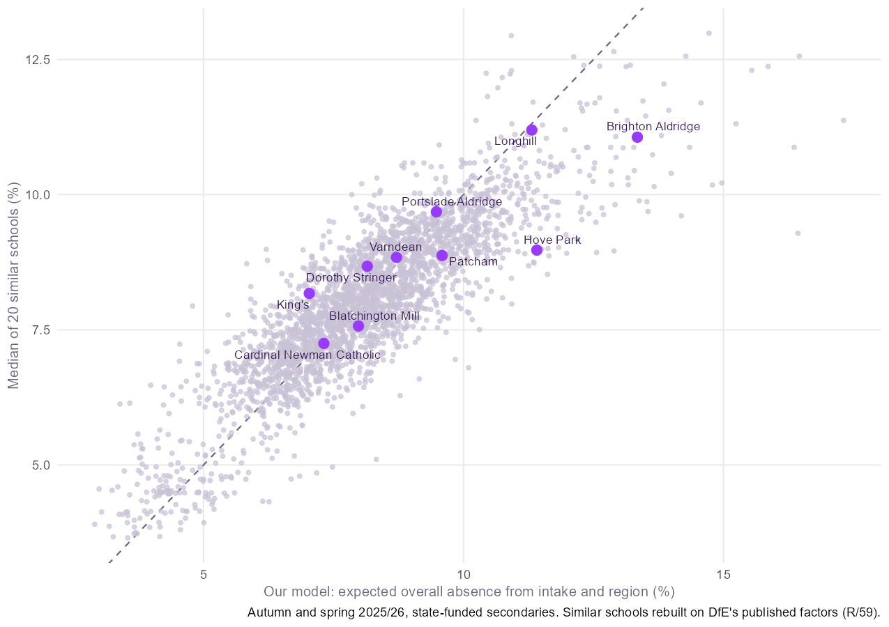

```{r setup}
#| include: false
source(here::here("R", "site_helpers.R"))
suppressPackageStartupMessages({ library(data.table); library(ggplot2); library(knitr) })
AB <- readRDS(here::here("data", "abie_benchmark.rds"))
ag <- AB$agree; B <- AB$B
a <- function(yr, v) ag[year == yr][[v]]
bs <- AB$bh_sum
b <- function(yr, v) bs[year == yr][[v]]
f1 <- function(x) sprintf("%.1f", x); f2 <- function(x) sprintf("%.2f", x)
short <- function(x) sub(" School and Sixth Form Centre| Catholic School| Community Academy| High School| School$", "", x)
```

::: {.callout-note}
## About this page
- **The question:** DfE now gives every school an *attendance baseline
  improvement expectation* (ABIE). How is it set, and does it agree with what
  our model says a school's absence should be, given its pupils?
- **The limit:** ABIE values are not published. Schools see their own, and local
  authorities receive school-level workbooks. So this page rebuilds the
  similar-schools comparison that ABIEs are based on, from published data, and
  compares that with our model. The real ABIEs can be added once we have a
  workbook.
- **Data:** published DfE school absence, census, SEN, finance and GIAS files,
  and the English Indices of Deprivation. No pupil-level records are used.
:::

## In short

- **ABIEs are set against 20 statistically similar schools.** DfE says each
  school's expectation is based on its previous attendance and "the progress of
  similar schools", matched on free school meals, SEN, deprivation, EAL,
  location, funding and size. The formula is not published.
- **Rebuilt from published data, that comparison agrees closely with our
  model.** Across `r format(a("2025/26", "schools"), big.mark = ",")` secondary
  schools, the median absence of each school's 20 similar schools and our
  model's expected absence correlate at **`r f2(a("2025/26", "r"))`** in
  2025/26, and at `r f2(min(ag$r))`--`r f2(max(ag$r))` in every year since
  2021/22. On average they differ by `r f1(a("2025/26", "mae"))` percentage points.
- **Our model predicts actual absence better** (r =
  `r f2(a("2025/26", "r_actual_model"))` against `r f2(a("2025/26", "r_actual_sim"))`),
  because it uses more of what a school's intake is like, including prior
  attainment, mobility and neighbourhood education.
- **Brighton and Hove's secondaries sit above both benchmarks.** In autumn and
  spring 2025/26 they averaged **`r f1(b("2025/26", "actual"))`%** absence.
  Our model expects `r f1(b("2025/26", "model"))`%; their similar schools'
  median is `r f1(b("2025/26", "sim_median"))`%, and the similar schools' top
  quarter `r f1(b("2025/26", "sim_q1"))`%.

## What an ABIE is {#sec-what}

- **What it is:** a school-level expectation of how far attendance should
  improve. DfE describes it as "the level of improvement expected from a school
  over time", and as a minimum, "intended to support ambition, not limit it".
- **How it is set:** from the school's previous attendance and the attendance
  of schools most like it. Each school's similar schools comparison report sets
  it against **20 statistically similar schools in the same phase**, matched
  on:
  - free school meals;
  - SEN support, including social, emotional and mental health (SEMH) need;
  - Gypsy, Roma and Traveller pupils;
  - IDACI deprivation of pupils' home postcodes;
  - region, urban or rural setting, and average travel distance;
  - English as an additional language;
  - funding per pupil;
  - number of pupils on roll.
- **The benchmarks in those reports:** each school is compared with the
  **median** of its 20 similar schools, and DfE uses **the top quarter** of
  similar schools as "a realistic target" when it identifies a school's areas
  of focus.
- **The time frame:** schools received an indicative one-year ABIE for
  2025/26. From September 2026 ABIEs are multi-year, setting the improvement
  expected **by the end of 2028/29**, and a school's ABIE does not change
  between reports.
- **Its status:** not an accountability measure, and not shared with Ofsted.
- **What is not public:** the formula, which attendance measure it is set on,
  and how the "progress of similar schools" becomes a school's expectation.
  Press reports of the Minister's letter describe the expectations as
  calibrated with AI; DfE's guidance does not say how.
- **Who has the numbers:** each school, in its own reports through DfE's
  *Monitor your school attendance* service; and each local authority, in
  separate primary and secondary **ABIE workbooks** holding school-level
  attendance and multi-year ABIEs for every school in its area.

## Rebuilding the comparison {#sec-rebuild}

For every state-funded secondary school in the absence models
(`r format(AB$n_match, big.mark = ",")` of `r format(AB$n_frame, big.mark = ",")`
have every factor), we found the 20 most similar schools on the factors DfE
lists that are published:

- **Matched on:** free school meals, SEN support, SEMH need, Gypsy, Roma and
  Traveller pupils and EAL (January 2026 census and SEN files); IDACI score of
  the school's own neighbourhood (DfE uses pupils' home postcodes); income per
  pupil in 2024-25 (CFR and academies' accounts); pupils on roll; and urban or
  rural setting. Each is standardised, and a school in another region counts
  as one standard unit further away.
- **Not matched on:** average travel distance, which is not published.
- **How this differs from our own twins:** see [Our twins and DfE's similar
  schools](twins.qmd#sec-dfe). The two sets share only a few schools.
- **Result:** `r round(100 * AB$same_region)`% of each school's similar schools
  are in its own region.
- **Benchmarks, each year:** the median overall absence of the 20, and their
  top quarter (the 25th percentile), for 2021/22 to 2024/25 (full years) and
  the autumn and spring terms of 2025/26. The same 20 schools are used every
  year.
- **Our model, each year:** the overall-absence model on
  [What goes with school absence](absence_causes.qmd#sec-full), refitted to
  each year, giving each school's expected absence from its intake and region
  (no local authority effect, as the similar-schools comparison has none).

## Does it agree with our model? {#sec-agree}

```{r}
#| label: fig-abie-scatter
#| fig-cap: "Expected overall absence from our model (intake and region) against the median of each school's 20 similar schools, state-funded secondaries, autumn and spring 2025/26. Brighton and Hove's schools in purple; dashed line: the two agree."

```

```{r}
#| label: tbl-abie-agree
#| tbl-cap: "Our model's expected absence and the similar-schools median, by year: agreement with each other, and with what schools actually recorded. Overall absence, state-funded secondaries; 2025/26 is autumn and spring only."
kable(ag[, .(Year = year, Schools = format(schools, big.mark = ","), `Model vs similar: r` = f2(r),
             `Mean gap (points)` = f2(mae), `Mean, model (%)` = f1(mean_model), `Mean, similar median (%)` = f1(mean_sim),
             `Mean, actual (%)` = f1(mean_actual), `Actual vs model: r` = f2(r_actual_model), `Actual vs similar: r` = f2(r_actual_sim))],
      align = "lrrrrrrrr")
```

- **They agree closely**, as they should: both ask what absence is usual for
  schools with pupils like these.
- **Our model is the better predictor of what schools actually record.** It
  uses prior attainment, mobility, neighbourhood education and the full mix of
  SEN need. The similar-schools median rests on 20 schools, so it is noisier.
- **The similar-schools median runs a little lower** than our model's
  expectation (by `r f2(a("2025/26", "mean_model") - a("2025/26", "mean_sim"))`
  points in 2025/26), because a median of skewed absence sits below the mean.

## Brighton and Hove {#sec-bh}

```{r}
#| label: fig-abie-bh
#| fig-cap: "Brighton and Hove's secondary schools, autumn and spring 2025/26: actual overall absence, our model's expectation, and the median and top quarter of each school's 20 similar schools."
#| fig-height: 5.2
P <- melt(AB$bh[year == "2025/26", .(school = short(SCHNAME), actual, model, sim_median, sim_q1)], id.vars = "school")
P[, variable := factor(variable, c("actual", "model", "sim_median", "sim_q1"),
                      c("Actual", "Our model", "Similar schools: median", "Similar schools: top quarter"))]
ord <- AB$bh[year == "2025/26"][order(actual), short(SCHNAME)]
P[, school := factor(school, ord)]
ggplot(P, aes(value, school)) +
  geom_line(aes(group = school), colour = LIGHT, linewidth = 1) +
  geom_point(aes(colour = variable, shape = variable), size = 3.2) +
  scale_colour_manual(values = c("Actual" = INK, "Our model" = BPURPLE, "Similar schools: median" = MPURPLE, "Similar schools: top quarter" = GREY), name = NULL) +
  scale_shape_manual(values = c(16, 16, 17, 1), name = NULL) +
  labs(x = "Overall absence, autumn and spring 2025/26 (% of sessions)", y = NULL) + theme_note(11) + theme(legend.position = "top")
```

```{r}
#| label: fig-abie-bh-years
#| fig-cap: "Brighton and Hove's secondary schools, average of the ten schools: actual overall absence against our model's expectation and the similar-schools benchmarks, 2021/22 to 2025/26 (2025/26 autumn and spring only, so lower in every series)."
#| fig-height: 4
Y <- melt(bs, id.vars = "year")
Y[, variable := factor(variable, c("actual", "model", "sim_median", "sim_q1"),
                      c("Actual", "Our model", "Similar schools: median", "Similar schools: top quarter"))]
ggplot(Y, aes(year, value, colour = variable, group = variable, linetype = variable)) + geom_line(linewidth = 1) + geom_point(size = 2.4) +
  scale_linetype_manual(values = c("solid", "solid", "solid", "dashed"), name = NULL) +
  scale_colour_manual(values = c("Actual" = INK, "Our model" = BPURPLE, "Similar schools: median" = MPURPLE, "Similar schools: top quarter" = GREY), name = NULL) +
  labs(x = NULL, y = "Overall absence (%), mean of schools") + theme_note(11) + theme(legend.position = "top")
```

```{r}
#| label: tbl-abie-bh
#| tbl-cap: "Brighton and Hove's secondary schools, autumn and spring 2025/26: overall absence (%), actual and against the three benchmarks."
kable(AB$bh[year == "2025/26"][order(-actual), .(School = SCHNAME, Actual = f1(actual), `Our model` = f1(model),
                                               `Similar median` = f1(sim_median), `Similar top quarter` = f1(sim_q1),
                                               `Actual minus model` = sprintf("%+.1f", actual - model))],
      align = "lrrrrr")
```

- **The city's schools have run above both benchmarks in every year.** The gap
  to our model's expectation was
  `r f1(b("2021/22", "actual") - b("2021/22", "model"))` points in 2021/22,
  `r f1(b("2024/25", "actual") - b("2024/25", "model"))` in 2024/25 and
  `r f1(b("2025/26", "actual") - b("2025/26", "model"))` in the first two terms of
  2025/26.
- **The two benchmarks mostly agree on which schools run above what their
  pupils predict:** Longhill, Blatchington Mill, Dorothy Stringer and Cardinal
  Newman are above both.
- **They disagree on two schools.** Our model expects much of Brighton
  Aldridge's and Hove Park's absence from their intakes, so on our model both
  sit at or below expectation. Their 20 similar schools have lower absence, so
  against the similar-schools median both look high. Which an ABIE follows
  matters for what is asked of these two schools.
- **An ABIE set from the similar-schools median or top quarter would ask the
  city's schools for more improvement than our model** does, because the
  similar-schools benchmarks run lower than our model's expectation.

## What a direct comparison needs {#sec-next}

- **The ABIE workbook.** Brighton and Hove City Council's attendance team holds
  the secondary ABIE workbook for the city's schools: school-level attendance
  and multi-year expectations to 2028/29. With it, each school's ABIE can be
  plotted against our model's expectation and the rebuilt similar-schools
  benchmarks above, and we can test which the ABIEs follow.
- **Travel distance.** DfE matches on pupils' average travel distance, which
  is not published. The routing data behind [Distance to school](distance.qmd)
  could stand in for it.

::: {.callout-tip collapse="true"}
## The method

**Similar schools.** For school $i$, the distance to school $j$ is

$$d_{ij} = \sum_{k} (z_{ik} - z_{jk})^2 + \mathbb{1}[\text{region}_i \neq \text{region}_j],$$

over the standardised factors $z_k$: FSM %, SEN support %, SEMH need %, Gypsy,
Roma and Traveller %, IDACI score of the school's LSOA (IoD 2019), EAL %,
income per pupil 2024-25, log pupils on roll, and urban/rural band (three
levels). The 20 smallest $d_{ij}$ are its similar schools. Equal weights are an
assumption: DfE does not publish its weights.

**Our model.** For each year $t$, log overall absence on the absence model's
school characteristics, with region and local authority random effects; the
expectation is

$$\hat y_{it} = \exp\left(x_i'\hat\beta_t + \hat u_{\text{region}(i),t}\right)\cdot \bar s_t - 0.1,$$

where $\bar s_t$ is the mean of the exponentiated residuals (a smearing
factor). The characteristics are those of January 2026 in every year.

```r
lmer(log(overall + 0.1) ~ fsm + sen_sup + ehcp + semh + ... + (1 | region / la), data = dd)   # R/59
predict(m, re.form = ~ (1 | region))
```

**Caveats.** The IDACI score is for the school's own neighbourhood, not
pupils' homes. Using the same 20 schools and the same characteristics every
year ignores changes in intake. DfE's own comparison uses daily attendance
data from the start of the year to the latest term, which can differ from the
published termly statistics.
:::

## Sources {#sec-sources}

- DfE (2026) [*Monitor your school attendance: user guide*](https://www.gov.uk/government/publications/monitor-your-school-attendance-user-guide/monitor-your-school-attendance-user-guide), updated 23 November 2026: the similar schools comparison and ABIEs.
- DfE, [*Pupil attendance in schools*](https://explore-education-statistics.service.gov.uk/find-statistics/pupil-attendance-in-schools) and its [methodology](https://explore-education-statistics.service.gov.uk/methodology/pupil-attendance-in-schools).
- Reports of the Minister's letter on ABIEs: [SecEd](https://www.sec-ed.co.uk/content/news/schools-ai-powered-student-attendance-targets-absence); [Tes](https://www.tes.com/magazine/news/general/dfe-sets-ai-attendance-targets-for-schools); [Browne Jacobson](https://www.brownejacobson.com/insights/school-attendance-targets-2026-what-your-abie-means); [NGA](https://www.nga.org.uk/knowledge-centre/improving-school-attendance/).
- Data: DfE *Pupil absence in schools in England* (school level, 2021/22 to 2024/25; autumn and spring 2025/26); *Schools, pupils and their characteristics* and *Special educational needs in England*, January 2026; consistent financial reporting and academies accounts return, 2024-25; Get Information about Schools; English Indices of Deprivation 2019 (IDACI).
- Ours: `R/08_absence_causes.R` (the absence models), `R/59_abie_benchmark.R` (this page).
