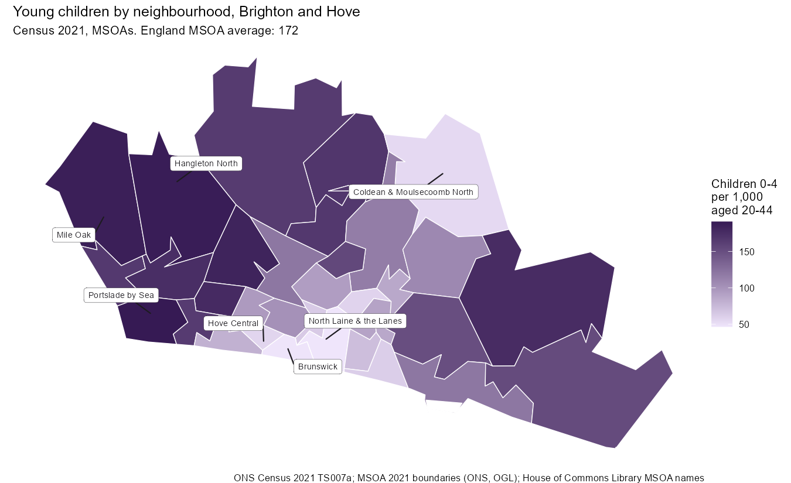
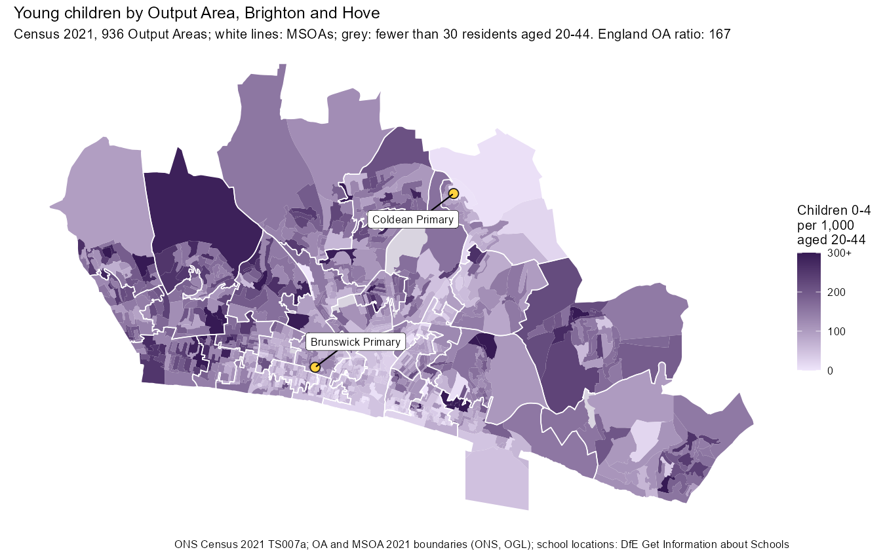
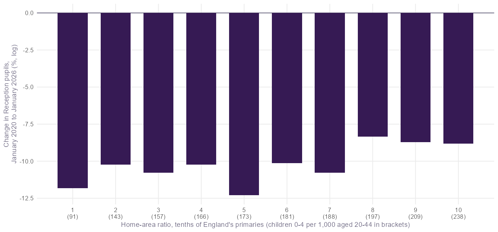
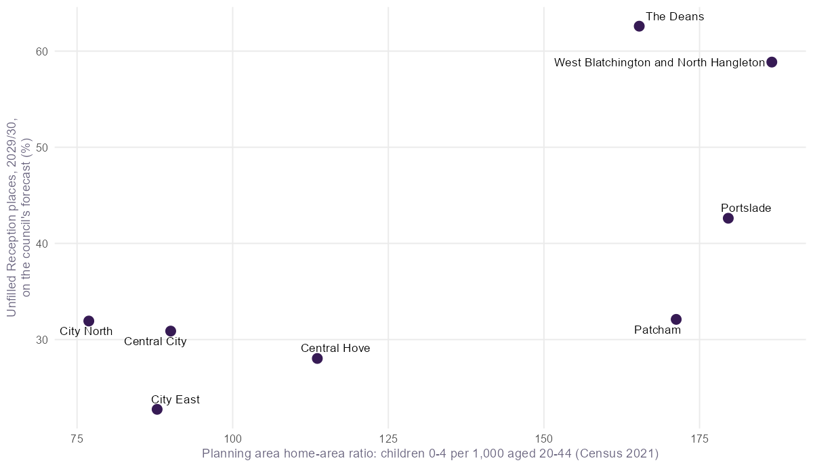
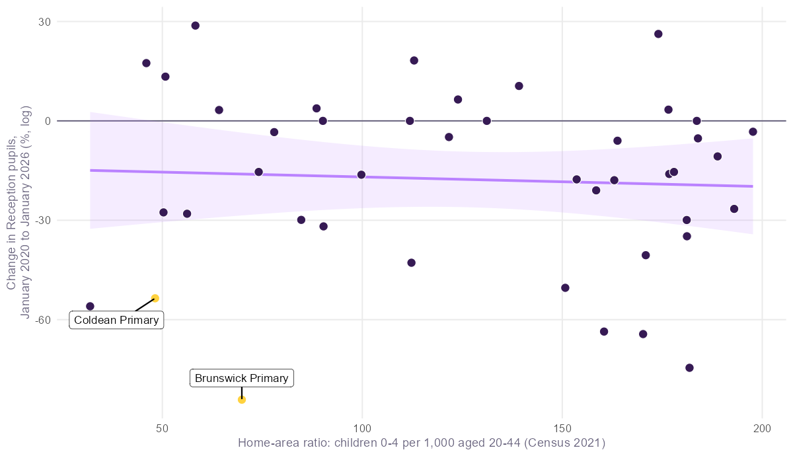

```{r setup}
#| include: false
source(here::here("R", "site_helpers.R"))
suppressPackageStartupMessages({ library(data.table); library(leaflet) })
D <- readRDS(here::here("data", "demographics.rds"))
YG <- D$yeargroups; TR <- D$trend; EV <- D$events; PR <- D$proj
LA <- TR[level == "Local authority"]
eng <- TR[area == "England"]
y0 <- yl(D$t0); y1 <- yl(max(D$years)); yfirst <- yl(min(D$years))
nat <- YG[area == "England"][order(year)]
cls_n <- table(LA$primary_class)
sec_cls_n <- table(LA$secondary_class)
falling <- cls_n[["Consistent decline"]] + cls_n[["Decline"]]
# closures and openings by trend class, primary schools
pr <- LA[, .(areas = .N, schools = sum(primary_open, na.rm = TRUE), closed = sum(Primary_Closed, na.rm = TRUE),
             merged = sum(Primary_Merged, na.rm = TRUE), opened = sum(Primary_Opened, na.rm = TRUE)), by = primary_class][order(primary_class)]
pr[, `:=`(gone_rate = 100 * (closed + merged) / schools, open_rate = 100 * opened / schools)]
rate <- function(cl, v) pr[[v]][pr$primary_class == cl]
y7_falls <- LA[order(y7_chg_2032)]
ev_n <- EV[, .N, by = .(event, stage)]
evn <- function(e, s) ev_n[event == e & stage == s, N]
dfe <- D$dfe_check
dfe_chg <- if (!is.null(dfe)) 100 * (dfe$pupils[dfe$model_year == 2030] / dfe$pupils[dfe$model_year == 2025] - 1) else NA
our_chg <- 100 * (PR[area == "England" & year == "2029-30", secondary] / nat[year == "2024-25", secondary] - 1)
# areas: change in primary-age pupils against primary schools closed or merged per 100 open
sc <- LA[primary_open > 0, .(area, chg = primary_chg, gone = 100 * (Primary_Closed + Primary_Merged) / primary_open,
                             london = region == "London")]
fit <- lm(gone ~ chg, data = sc)
fit_nl <- lm(gone ~ chg, data = sc[london == FALSE])   # outside London
CLS_COL <- c("Consistent decline" = "#762a83", "Decline" = "#c2a5cf", "Stable" = "#d9d9e3", "Growth" = "#a6dba0", "Consistent growth" = "#1b7837")
```

::: {.callout-note appearance="simple"}
## In short

- **Primary rolls are falling almost everywhere.** England's primary-age pupils
  (Reception to Year 6) peaked in `r yl(eng$primary_peak_year)` and are
  `r pts(abs(eng$primary_from_peak), 1)`% down by `r y1`. Since `r y0`,
  `r cls_n[["Consistent decline"]]` of `r nrow(LA)` areas have fallen in nearly
  every year and by 5% or more, and `r cls_n[["Decline"]]` more by 3% or more; only
  `r cls_n[["Growth"]] + cls_n[["Consistent growth"]]` have grown.
- **The fall reaches secondary schools next.** The cohorts already in primary
  school mean England's Year 7 intake will be about
  `r pts(abs(eng$y7_chg_2032), 0)`% smaller in 2032/33 than in `r y1`, with no
  assumption about births at all, and much more in some places: in
  `r sum(LA$y7_chg_2032 <= -15, na.rm = TRUE)` areas by 15% or more.
- **Closures have followed falling rolls in London, less so elsewhere.** Since
  2015/16, `r evn("Closed", "Primary")` state primary schools have closed with
  no successor and `r evn("Merged", "Primary")` have merged, and
  `r evn("Opened", "Primary")` genuinely new ones opened. In areas in consistent
  decline, `r pts(rate("Consistent decline", "gone_rate"), 1)` have closed or
  merged for every 100 open now, twice the rate in stable areas
  (`r pts(rate("Stable", "gone_rate"), 1)`). But that is mostly inner London;
  elsewhere most falling areas have closed few schools so far and carry
  surplus places instead.
- **Fertility has fallen, and housing costs explain little of it.** England's
  total fertility rate fell from 1.83 in 2013 to 1.39 in 2025, and Brighton and
  Hove's to 0.98.
  - The fall is mostly among women in their twenties.
  - The lowest-fertility places are university cities, whatever their house
    prices.
  - Fertility fell about as much where housing became less affordable as where
    it did not ([see below](#sec-fertility)).
- **Within Brighton and Hove, the shortfall of young children is in the
  centre.**
  - Brunswick, the North Laine, Hove Central and Coldean have about a third of
    England's ratio of under-fives to adults aged 20 to 44. The edges of the
    city are at or above England's.
  - Neighbourhood make-up accounts for almost all of the city's gap: many adults
    in their early twenties, graduates, few married couples and private renting
    ([see below](#sec-within-city)).
  - Street by street, a fifth of the city's Output Areas have fewer than 60
    under-fives per 1,000 adults aged 20 to 44, against one in twenty across
    England ([see below](#sec-oa)).
- **But few young children nearby does not tell you which schools lose pupils.**
  Across England, primaries in low-child areas have not lost Reception pupils
  faster than others in the same authority. Brighton and Hove's own forecasts
  leave the most empty places in its outer planning areas, not the centre
  ([see below](#sec-intakes)).
- **The fall itself is national.**
  - Nothing that changed locally explains why some places fell more:
    affordability, young women's share, or women aged 25 to 39 moving in or out.
  - Brighton and Hove fell about as much as the average district.
  - Unusually, its births at 30 and over fell as much as those under 30
    ([see below](#sec-fertility-fall)).
:::

## England: the wave passing through {#sec-wave}

The large cohorts born around 2010 to 2012 have moved out of primary school and
are now in secondary school; smaller cohorts follow them. Each cohort in
school in January 2026 can be rolled forward a year at a time, using each
area's recent movement between year groups, so the next seven years of Year 7
intakes are already largely known.

```{r}
#| label: fig-wave
#| fig-cap: "State-funded primary and secondary schools in England: pupils of primary age (Reception to Year 6) and secondary age (Years 7 to 11), January censuses, then the cohorts in school rolled forward (dashed). Diamonds are DfE's own national projection (ages 11 to 15), for comparison."
#| fig-height: 4.6
w <- rbind(nat[, .(year, `Primary age (R-Y6)` = primary, `Secondary age (Y7-11)` = secondary, kind = "Census")] |>
             melt(id.vars = c("year", "kind"), variable.name = "group", value.name = "pupils"),
           PR[area == "England" & !is.na(secondary), .(year, group = "Secondary age (Y7-11)", pupils = secondary, kind = "Rolled forward")])
w <- rbind(w, w[kind == "Census" & year == max(D$years) & group == "Secondary age (Y7-11)"][, kind := "Rolled forward"])
w[, x := as.integer(substr(year, 1, 4))]
dd <- if (!is.null(dfe)) dfe[model_year >= 2016, .(x = model_year - 1, pupils, group = "Secondary age (Y7-11)")] else NULL
p <- ggplot(w, aes(x, pupils / 1e6, colour = group, linetype = kind)) + geom_line(linewidth = 1.1) +
  geom_point(data = w[kind == "Census"], size = 1.8) +
  scale_colour_manual(values = c("Primary age (R-Y6)" = BPURPLE, "Secondary age (Y7-11)" = DPURPLE)) +
  scale_linetype_manual(values = c(Census = "solid", `Rolled forward` = "dashed")) +
  scale_x_continuous(breaks = seq(2015, 2030, 3), labels = function(x) paste0(x, "/", substr(x + 1, 3, 4))) +
  labs(x = NULL, y = "Pupils (millions)", colour = NULL, linetype = NULL) + theme_note()
if (!is.null(dd)) p <- p + geom_point(data = dd, aes(x, pupils / 1e6), inherit.aes = FALSE, shape = 5, colour = GREY, size = 2)
p
```

Rolled forward this way, England's secondary-age pupils fall by
`r pts(abs(our_chg), 1)`% between 2024/25 and 2029/30; DfE's national
projection, made separately from the same censuses and from population
estimates, gives `r pts(abs(dfe_chg), 1)`%. The two agree closely, which is a
check on the method used for every area below.

## Where rolls are growing and falling {#sec-map}

Each local authority is classed by the path of its primary-age pupils since
`r y0` (seven year-on-year changes): **consistent decline** if they fell in at
least six of the seven years and by 5% or more in all, **decline** if they fell
by 3% or more, **growth** and **consistent growth** the same upwards, and
**stable** otherwise. Three reorganised councils are combined so that their
series run unbroken (see [the data](#sec-demog-data)). The map also shows
every state mainstream school that has opened, closed or merged since
2015/16; switch layers with the control at the top right.

```{r}
#| label: fig-demog-map
#| column: page
#| fig-cap: "Primary-age pupils, change since 2018/19, by local authority, and the coming change in Year 7 intakes. Points: state mainstream schools opened (green), closed with no successor (purple) and merged (pale purple) since 2015/16. Click an area or a school for details."
b <- merge(D$bounds, LA, by = "area")
cap <- 20
PRGN9 <- c("#762a83", "#9970ab", "#c2a5cf", "#e7d4e8", "#f7f7f7", "#d9f0d3", "#a6dba0", "#5aae61", "#1b7837")   # ColorBrewer PRGn, as on the site's maps
pal_p <- colorNumeric(PRGN9, c(-cap, cap))
cl <- function(v) pmax(pmin(v, cap), -cap)
lab <- sprintf("<b>%s</b><br>Primary age, %s to %s: %+.1f%% (%s)<br>Secondary age: %+.1f%% (%s)<br>Year 7 intake by 2032/33: %+.1f%%<br>Primary schools since 2015/16: %d closed, %d merged, %d opened",
               b$area, y0, y1, b$primary_chg, b$primary_class, b$secondary_chg, b$secondary_class, b$y7_chg_2032,
               as.integer(b$Primary_Closed), as.integer(b$Primary_Merged), as.integer(b$Primary_Opened))
ev <- EV[!is.na(lat)]
ev_col <- c(Opened = "#1b7837", Closed = "#762a83", Merged = "#c2a5cf")
ev_lab <- sprintf("<b>%s</b><br>%s, %s %s<br>%s%s", ev$name, ev$area, tolower(ev$event), yl(ev$year), ev$stage,
                  ifelse(is.na(ev$pupils), "", paste0(", ", ev$pupils, " pupils on its last record")))
leaflet(height = 680, options = leafletOptions(scrollWheelZoom = FALSE)) |>
  addProviderTiles("Esri.WorldGrayCanvas") |> setView(-1.6, 52.8, 6) |>
  addPolygons(data = b, fillColor = ~pal_p(cl(primary_chg)), fillOpacity = 0.8, color = "white", weight = 0.6,
              popup = lab, group = "Primary-age change since 2018/19") |>
  addPolygons(data = b, fillColor = ~pal_p(cl(y7_chg_2032)), fillOpacity = 0.8, color = "white", weight = 0.6,
              popup = lab, group = "Year 7 intake, 2025/26 to 2032/33") |>
  addCircleMarkers(data = ev[event == "Closed"], lng = ~lon, lat = ~lat, radius = 2.8, color = "white", weight = 0.8,
                   fillColor = ev_col[["Closed"]], fillOpacity = 0.95, popup = ev_lab[ev$event == "Closed"], group = "Closed") |>
  addCircleMarkers(data = ev[event == "Merged"], lng = ~lon, lat = ~lat, radius = 2.8, color = "#762a83", weight = 0.8,
                   fillColor = ev_col[["Merged"]], fillOpacity = 0.95, popup = ev_lab[ev$event == "Merged"], group = "Merged") |>
  addCircleMarkers(data = ev[event == "Opened"], lng = ~lon, lat = ~lat, radius = 2.8, color = "white", weight = 0.8,
                   fillColor = ev_col[["Opened"]], fillOpacity = 0.95, popup = ev_lab[ev$event == "Opened"], group = "Opened") |>
  addLegend("bottomright", pal = pal_p, values = c(-cap, cap), title = "% change", labFormat = labelFormat(suffix = "%"), opacity = 0.9) |>
  addLegend("bottomleft", colors = unname(ev_col), labels = c("Opened", "Closed (no successor)", "Merged"), title = "Schools since 2015/16", opacity = 0.95) |>
  addLayersControl(baseGroups = c("Primary-age change since 2018/19", "Year 7 intake, 2025/26 to 2032/33"),
                   overlayGroups = c("Closed", "Merged", "Opened"), options = layersControlOptions(collapsed = FALSE))
```

Colours are capped at ±`r cap`%. The fall is steepest in inner London:
`r and_list(head(LA[order(primary_chg), area], 5))` have lost
`r pts(abs(max(head(LA[order(primary_chg), primary_chg], 5))), 0)`% to
`r pts(abs(min(LA$primary_chg)), 0)`% of their primary-age pupils since `r y0`,
`r sum(LA[region == "London", primary_class] == "Consistent decline")` of
London's `r sum(LA$region == "London")` boroughs are in consistent decline. Across
England, Reception classes have fallen faster than primary schools as a whole
(`r pts(abs(eng$reception_chg), 1)`% since `r y0`), so the fall has further to run. The areas still growing are
`r and_list(LA[primary_chg >= 3][order(-primary_chg), area])`.

## Closures and falling rolls {#sec-closures}

```{r}
#| label: tbl-class-closures
#| tbl-cap: "Local authorities by the path of their primary-age pupils since 2018/19, and state primary schools closed, merged and opened from 2015/16 to 2025/26, per 100 primary schools open now."
pr[, .(`Primary-age pupils since 2018/19` = primary_class, Areas = areas, `Primary schools open` = schools,
       Closed = closed, Merged = merged, Opened = opened,
       `Closed or merged per 100` = sprintf("%.1f", gone_rate), `Opened per 100` = sprintf("%.1f", open_rate))] |>
  kt(align = "lrrrrrrr")
```

```{r}
#| label: fig-closure-scatter
#| fig-cap: "Each local authority: change in primary-age pupils since 2018/19 against state primary schools closed or merged since 2015/16, per 100 open now. London boroughs in dark purple. The line is a least-squares fit."
#| fig-height: 5
ggplot(sc, aes(chg, gone)) + geom_vline(xintercept = 0, colour = LIGHT) +
  geom_smooth(method = "lm", formula = y ~ x, colour = GREY, fill = PPURPLE, linewidth = 0.7) +
  geom_point(aes(colour = london), size = 2.2, alpha = 0.85) +
  ggrepel::geom_text_repel(data = sc[gone >= 8 | chg <= -15 | chg >= 4], aes(label = area), size = 3, colour = INK, max.overlaps = 20) +
  scale_colour_manual(values = c(`TRUE` = DPURPLE, `FALSE` = MPURPLE), labels = c(`TRUE` = "London", `FALSE` = "Elsewhere")) +
  labs(x = paste0("Primary-age pupils, % change ", y0, " to ", y1), y = "Primary schools closed or merged per 100", colour = NULL) +
  theme_note()
```

Across authorities, each further 10% fall in primary-age pupils goes with about
`r pts(10 * -coef(fit)[["chg"]], 1)` more closures or mergers per 100 primary
schools (t = `r pts(-summary(fit)$coefficients["chg", "t value"], 1)`). London
carries almost all of this: outside London the slope is
`r pts(10 * -coef(fit_nl)[["chg"]], 1)` per 10% (t =
`r pts(-summary(fit_nl)$coefficients["chg", "t value"], 1)`), with Brighton and
Hove, the Isle of Wight and Bracknell Forest among the areas that have closed
most for their size. Closing a
school is slow, contested and local, so most falling areas have so far closed
few, and empty places are carried as surplus instead: the closures so far are
the start, not the measure, of the adjustment.

::: {.callout-note collapse="true"}
## The model behind this chart

$$\text{closed or merged per 100}_a = \beta_0 + \beta_1\,\text{\% change in primary-age pupils}_a + \varepsilon_a$$

```r
lm(gone ~ chg, data = sc)   # one row per local authority (n = `r nrow(sc)`)
```

An association across areas, not a forecast for any one school.
:::

## Troubles ahead for secondary schools {#sec-secondary}

Secondary rolls are still near their peak in most places, because the large
cohorts are in Years 7 to 11 now. The primary cohorts behind them decide what
comes next.

```{r}
#| label: fig-y7
#| fig-cap: "The 20 local authorities whose Year 7 intake falls most between 2025/26 and 2032/33, from the cohorts now in primary school rolled forward, and England."
#| fig-height: 6
t20 <- rbind(LA[order(y7_chg_2032)][1:20], eng, fill = TRUE)
t20[, area := factor(area, rev(area))]
ggplot(t20, aes(y7_chg_2032, area)) + geom_vline(xintercept = 0, colour = GREY) +
  geom_segment(aes(x = 0, xend = y7_chg_2032, yend = area), colour = LPURPLE, linewidth = 1.3) +
  geom_point(aes(colour = area == "England"), size = 2.8) +
  scale_colour_manual(values = c(`TRUE` = INK, `FALSE` = DPURPLE), guide = "none") +
  labs(x = "Year 7 intake, % change 2025/26 to 2032/33", y = NULL) + theme_note()
```

In `r sum(LA$y7_chg_2032 <= -15, na.rm = TRUE)` areas Year 7 shrinks by 15% or
more by 2032/33, and in `r sum(LA$y7_chg_2032 <= -10, na.rm = TRUE)` by 10% or
more. For secondary schools funded largely per pupil, that is the scale of the
financial pressure to come; a later page will look at schools' finances in the
years before closure.

## Births, fertility and the cost of housing {#sec-fertility}

```{r}
#| include: false
FA <- readRDS(here::here("data", "bh_fertility_affordability.rds"))
fe <- FA$A[name == "England" & from == 2013]; fb <- FA$A[name == "Brighton and Hove" & from == 2013]
DC <- FA$D_chg; bhd <- DC[name == "Brighton and Hove"]
nb <- DC[name %in% c("Lewes", "Mid Sussex", "Wealden")]
pan <- FA$D_panel
eng_ser <- FA$tfr_series[name == "England"][order(year)]
```

The sections above roll forward children already born. Behind them is a fall
in births, and the question is why.

- **England:** births fell `r pts(abs(fe$births), 0)`% from 2013 to 2025, even
  though the number of women aged 15 to 44 rose `r pts(fe$women_15_44, 0)`%.
  Births per woman fell faster than women grew.
- **Total fertility rate:** from `r fe$tfr_from` to `r fe$tfr_to` children per
  woman.
- **Brighton and Hove:** from `r fb$tfr_from` to `r fb$tfr_to`, the 2nd lowest
  of `r FA$n_districts` districts.

Councillors and commentators often put this down to the cost of living and of
housing. The data on where and when fertility fell give that view only weak
support.

```{r}
#| label: fig-asfr
#| fig-cap: "Age-specific fertility rates, England and Brighton and Hove, 2013 to 2025: births per 1,000 women in each age group. ONS birth rates by local authority (Nomis NM_207_1)."
#| fig-height: 4.4
B <- FA$B[age != "Under 20"]
B[, name := factor(name, c("England", "Brighton and Hove"))]
ggplot(B, aes(year, rate, colour = age)) + geom_line(linewidth = 1) + geom_point(size = 1) +
  facet_wrap(~name) + scale_colour_manual(values = c("20-24" = "#d9c2f5", "25-29" = "#a774f0", "30-34" = "#7a2fd6", "35-39" = "#4d1a8c", "40-44" = "#1f0a36")) +
  scale_x_continuous(breaks = c(2013, 2017, 2021, 2025)) +
  labs(x = NULL, y = "Births per 1,000 women", colour = "Age of mother") + theme_note(11)
```

**The fall is in the twenties.** From 2013 to 2025, England's fertility at ages
20 to 24 fell by `r pts(abs(FA$B_chg[name == "England" & age == "20-24", chg]), 0)`%
and at 25 to 29 by `r pts(abs(FA$B_chg[name == "England" & age == "25-29", chg]), 0)`%.
At 35 to 39 it fell by `r pts(abs(FA$B_chg[name == "England" & age == "35-39", chg]), 0)`%,
and at 40 to 44 it did not fall at all. Women are having children later, and
fewer of them.

- **Brighton and Hove has the same pattern, more strongly.** In 2025 its rate at
  20 to 24 was a quarter of England's, and at 25 to 29 under half.
- **At 35 to 39 it is higher than England's.**
- **Mothers' standardised mean age** was `r fb$mean_age_to` against England's
  `r fe$mean_age_to`.

```{r}
#| label: fig-tfr-low
#| fig-cap: "The 20 districts with the lowest total fertility rate, 2023 to 2025 (average of the three years; left), and the same districts' ratio of median house price to median residence-based earnings (right). Dashed lines are England. London boroughs in grey. ONS birth rates (Nomis NM_207_1); ONS housing affordability, table 5c."
#| fig-height: 5.8
low <- DC[order(tfr_1)][1:20]
low[, name := factor(name, rev(name))]
low[, where := fifelse(substr(code, 1, 3) == "E09", "London borough", fifelse(name == "Brighton and Hove", "Brighton and Hove", "Elsewhere"))]
eng_ratio <- FA$C[name == "England" & year %in% 2023:2025, mean(ratio)]
eng_tfr <- FA$tfr_series[name == "England" & year %in% 2023:2025, mean(tfr)]
WCOL <- c("Brighton and Hove" = BPURPLE, "Elsewhere" = DPURPLE, "London borough" = GREY)
pa <- ggplot(low, aes(tfr_1, name)) + geom_vline(xintercept = eng_tfr, colour = GREY, linetype = "dashed") +
  geom_segment(aes(x = 0, xend = tfr_1, yend = name, colour = where), linewidth = 1.1, alpha = 0.35) +
  geom_point(aes(colour = where), size = 2.8) +
  annotate("text", x = eng_tfr, y = 20.6, label = sprintf("England %.2f", eng_tfr), hjust = 1.05, size = 3, colour = GREY) +
  scale_colour_manual(values = WCOL, guide = "none") + scale_x_continuous(limits = c(0, 1.5), expand = expansion(mult = c(0, 0.02))) +
  coord_cartesian(clip = "off") +
  labs(x = "Total fertility rate (children per woman)", y = NULL) + theme_note(11)
pb <- ggplot(low, aes(ratio_1, name, fill = where)) + geom_col(width = 0.65) +
  geom_vline(xintercept = eng_ratio, colour = INK, linetype = "dashed") +
  annotate("text", x = eng_ratio, y = 20.6, label = sprintf("England %.1f", eng_ratio), hjust = -0.05, size = 3, colour = INK) +
  scale_fill_manual(values = WCOL, name = NULL) + scale_x_continuous(expand = expansion(mult = c(0, 0.05))) +
  coord_cartesian(clip = "off") +
  labs(x = "House price to earnings ratio", y = NULL) + theme_note(11) +
  theme(axis.text.y = element_blank(), legend.position = "bottom")
patchwork::wrap_plots(pa, pb, nrow = 1, widths = c(1.15, 1)) + patchwork::plot_layout(guides = "collect") & theme(legend.position = "bottom")
```

**The lowest-fertility places are university cities and inner London**, whatever
their house prices.

- The list includes Cambridge, Brighton and Hove, Norwich, York, Exeter and
  Oxford.
- **Norwich**, with a house price to earnings ratio of only
  `r sprintf("%.1f", DC[name == "Norwich", ratio_1])`, has fertility of
  `r sprintf("%.2f", DC[name == "Norwich", tfr_1])`.
- **Brighton and Hove's neighbours** Lewes, Mid Sussex and Wealden face almost
  the same ratio (`r sprintf("%.1f", min(nb$ratio_1))` to `r sprintf("%.1f", max(nb$ratio_1))`,
  against `r sprintf("%.1f", bhd$ratio_1)`), but have fertility of
  `r sprintf("%.2f", min(nb$tfr_1))` to `r sprintf("%.2f", max(nb$tfr_1))`.

That points to **who lives where at family-forming ages** more than to prices:
students and young single adults in the cities, and couples moving out to have
children.

```{r}
#| label: fig-afford
#| fig-cap: "Each district in England. Left, total fertility rate against the house price to earnings ratio (log scale), 2023 to 2025. Right, the change in each from 2013-15 to 2023-25. Brighton and Hove and three neighbours are labelled. Lines are least-squares fits."
#| fig-height: 4.8
lab <- DC[name %in% c("Brighton and Hove", "Lewes", "Mid Sussex", "Wealden")]
p1 <- ggplot(DC, aes(ratio_1, tfr_1)) + geom_point(colour = LPURPLE, alpha = 0.8, size = 1.5) +
  geom_smooth(method = "lm", formula = y ~ log(x), se = FALSE, colour = GREY, linewidth = 0.7) +
  geom_point(data = lab, colour = DPURPLE, size = 2.6) + ggrepel::geom_text_repel(data = lab, aes(label = name), colour = DPURPLE, size = 3, min.segment.length = 0, box.padding = 0.5, seed = 49) +
  scale_x_log10() + labs(x = "House price to earnings ratio, 2023-25", y = "Total fertility rate, 2023-25") + theme_note(10)
p2 <- ggplot(DC, aes(pct_ratio, pct_tfr)) + geom_point(colour = LPURPLE, alpha = 0.8, size = 1.5) +
  geom_smooth(method = "lm", formula = y ~ x, se = FALSE, colour = GREY, linewidth = 0.7) +
  geom_point(data = lab, colour = DPURPLE, size = 2.6) + ggrepel::geom_text_repel(data = lab, aes(label = name), colour = DPURPLE, size = 3, min.segment.length = 0, box.padding = 0.5, seed = 49) +
  labs(x = "Change in ratio, 2013-15 to 2023-25 (%)", y = "Change in fertility rate (%)") + theme_note(10)
patchwork::wrap_plots(p1, p2, nrow = 1)
```

**Affordability explains little of either picture.**

- **Levels:** across districts, the house price to earnings ratio accounts for
  `r pts(100 * FA$r2_lvl, 0)`% of the differences in fertility in 2023 to 2025.
  Brighton and Hove sits `r sprintf("%.2f", abs(bhd$resid_lvl))` children per
  woman below what its ratio predicts, the 2nd largest gap.
- **Change:** fertility fell about as much where housing became less affordable
  as where it did not (R² = `r sprintf("%.3f", FA$r2_chg)`).
- **Over time within each district**, against the national trend:
  - affordability in the same year has no detectable effect;
  - affordability three years earlier comes out with the opposite sign to the
    cost-of-living story. That more likely reflects who moves where than any
    effect of prices.

On their own, house prices say little about how many children are born. Once
who lives where is allowed for, prices and private renting play a modest part,
smaller than education or partnership ([below](#sec-fertility-drivers)).

::: {.callout-note collapse="true"}
## The models behind this section

Within districts over time, with district and year effects, so that only each
district's own change against the national trend counts (`r pan$districts`
districts, `r pan$years[1]` to `r pan$years[2]`):

$$\text{TFR}_{dt} = \alpha_d + \gamma_t + \beta_1 \log(\text{ratio}_{dt}) + \beta_2 \log(\text{ratio}_{d,t-3}) + \varepsilon_{dt}$$

```r
lm(tfr ~ lr + lr_lag3_full + factor(code) + factor(year), data = P)
```

- Same year: β₁ = `r sprintf("%.3f", pan$both["lr", 1])` (s.e. `r sprintf("%.3f", pan$both["lr", 2])`).
- Three years earlier: β₂ = `r sprintf("%.3f", pan$both["lr_lag3_full", 1])` (s.e. `r sprintf("%.3f", pan$both["lr_lag3_full", 2])`).

A doubling of the ratio is a change of 0.69 in its log.

Change across districts, 2013-15 to 2023-25:

```r
lm(d_tfr ~ d_lr, data = D_chg)    # R² = `r sprintf("%.3f", FA$r2_chg)`
lm(tfr_1 ~ log(ratio_1), data = D_chg)   # levels, R² = `r sprintf("%.3f", FA$r2_lvl)`
```

Associations across places, not effects on any one family. The total fertility
rate is a period measure for whoever lives in a district that year. Where young
adults move in to study or work and leave before having children, it is low
without any change in what any woman eventually does.
:::

## What goes with low fertility? {#sec-fertility-drivers}

```{r}
#| include: false
FD <- readRDS(here::here("data", "fertility_drivers.rds"))
fdr <- FD$r2; fbp <- FD$bh_parts; fco <- FD$coefs
part <- function(v) fbp[term == v, contribution]
```

Housing costs explain little of the differences in fertility between places;
who lives there explains much more.
- **Women's education:** the share of women aged 25 to 44 with a degree or
  other Level 4+ qualification alone accounts for `r pts(100 * fdr[["education"]], 0)`% of
  the differences in fertility across `r FD$n` districts. House prices alone
  account for `r pts(100 * fdr[["affordability"]], 0)`%.
- **Census make-up:** add the share of women of childbearing age who are 20 to
  24 (largely students), partnership, private renting and the share born
  abroad, and the model accounts for `r pts(100 * fdr[["full"]], 0)`%.
- **Housing still counts once make-up is allowed for:** higher house prices and
  more private renting both go with lower fertility, but less than education or
  partnership.

```{r}
#| label: fig-fert-drivers
#| fig-cap: "Total fertility rate, 2023-25, across districts in England: the change with one standard deviation more of each measure, all six in one model, with 95% intervals. Census 2021 (ONS and Nomis: qualifications by sex and age, TS002, TS054, TS004); ONS housing affordability; ONS birth rates."
#| fig-height: 4
fco[, label := factor(label, fco[order(est), label])]
ggplot(fco, aes(est, label)) + geom_vline(xintercept = 0, colour = GREY) +
  geom_linerange(aes(xmin = lo, xmax = hi), colour = MPURPLE, linewidth = 1.2) +
  geom_point(colour = DPURPLE, size = 3) +
  labs(x = "Children per woman, per standard deviation", y = NULL) + theme_note(11)
```

::: {.callout-note collapse="true"}
## The model behind this chart

$$\text{TFR}_d = \beta_0 + \beta_1 z(\text{women 25-44 Level 4+})_d + \beta_2 z(\text{women 20-24 share})_d + \beta_3 z(\text{married})_d + \beta_4 z(\text{private renting})_d + \beta_5 z(\text{born abroad})_d + \beta_6 z(\log \text{ratio})_d + \varepsilon_d$$

```r
lm(tfr ~ fem_l4 + young + married + private_rent + born_abroad + log_ratio, data = Z)   # R/52; z = standardised
```

- n = `r FD$n` districts, R² = `r sprintf("%.2f", fdr[["full"]])`.
- R² lost by dropping each measure in turn:
  - women's Level 4+ `r sprintf("%.3f", fco[term == "fem_l4", unique_r2])`;
  - born abroad `r sprintf("%.3f", fco[term == "born_abroad", unique_r2])`;
  - women 20 to 24 `r sprintf("%.3f", fco[term == "young", unique_r2])`;
  - married `r sprintf("%.3f", fco[term == "married", unique_r2])`;
  - house prices `r sprintf("%.3f", fco[term == "log_ratio", unique_r2])`;
  - private renting `r sprintf("%.3f", fco[term == "private_rent", unique_r2])`.
- Four districts reorganised since the Census (Cumberland, Westmorland and Furness, North Yorkshire, Somerset) are left out.

Associations across places, not causes:
- Partnership and renting are partly part of the same life stage as not yet
  having children.
- The fertility rate is a period measure for whoever lives in a district.
:::

```{r}
#| label: fig-bh-parts
#| fig-cap: "Brighton and Hove's total fertility rate, 2023-25, against the average district: the part that goes with each measure in the model above (coefficient x Brighton and Hove's standardised value). The parts add to the model's prediction; the residual is shown as text."
#| fig-height: 3.6
fbp[, label := factor(label, fbp[order(contribution), label])]
ggplot(fbp, aes(contribution, label)) + geom_vline(xintercept = 0, colour = GREY) +
  geom_col(aes(fill = contribution < 0), width = 0.6) +
  scale_fill_manual(values = c(`TRUE` = DPURPLE, `FALSE` = MPURPLE), guide = "none") +
  labs(x = "Children per woman, against the average district", y = NULL) + theme_note(11)
```

**Brighton and Hove is not a puzzle once its make-up is allowed for.**
- **The gap:** its fertility is `r sprintf("%.2f", abs(FD$bh_gap))` children per
  woman below the average district. The model accounts for all of it (residual
  `r sprintf("%+.2f", FD$bh_res[["full"]])`, against `r sprintf("%.2f", FD$bh_res[["affordability"]])`
  with house prices alone).
- **The parts, in roughly equal measure:**
  - highly educated women (`r sprintf("%.2f", part("fem_l4"))`);
  - a young, largely student population (`r sprintf("%.2f", part("young"))`);
  - few people married or in civil partnerships
    (`r sprintf("%.2f", part("married"))`, `r FD$bh_ranks[["married"]]`th of
    `r FD$n`);
  - private renting (`r sprintf("%.2f", part("private_rent"))`);
  - house prices themselves (`r sprintf("%.2f", part("log_ratio"))`).
- **Housing, through renting and prices together,** is about a third of the gap.

**Education explains where fertility is low, not why it fell.** The rise in
adults with Level 4+ from 2011 to 2021 is unrelated to the fall in fertility
since 2013-15 across `r FD$change$n` districts (R² =
`r sprintf("%.3f", FD$change$r2)`). The fall is a national shift, as it is
for housing.

## Fewer births, or families moving away? {#sec-births-migration}

```{r}
#| include: false
BM <- readRDS(here::here("data", "pupils_births_migration.rds"))
BX <- BM$X; VS <- BM$var_share
PRI <- "Primary (Reception to Year 6)"
bx <- function(a, g = PRI) BX[area == a & group == g]
e_p <- bx("England"); b_p <- bx("Brighton and Hove"); b_7 <- bx("Brighton and Hove", "Year 7")
lon_p <- BM$by_region[group == PRI & region == "London"]
vs <- function(g, v) VS[group == g][[v]]
```

Pupils in an area are the children born there, adjusted for those who have
moved in or out since, and for the share who go to its state mainstream
schools. Split this way, the change in pupils from 2018/19 to 2025/26 shows how
much is births and how much is families moving.
- **England:** primary pupils fell by `r pts(abs(e_p$total), 1)` log points
  (×100).
  - Births alone would have cut them by `r pts(abs(e_p$births), 1)`.
  - Net migration of children *into* England added `r pts(e_p$migration, 1)`.
  - A smaller share in state mainstream schools took off
    `r pts(abs(e_p$schooling), 1)`: more in special schools, home education and
    independent schools.
- **Brighton and Hove:** the fall (`r pts(abs(b_p$total), 1)`) is almost all
  births (`r pts(b_p$births, 1)`). Migration (`r sprintf("%+.1f", b_p$migration)`)
  and the state-school share (`r sprintf("%+.1f", b_p$schooling)`) slightly
  offset it.
  - The city does lose children. Only about `r pts(100 * b_p$retain_2, 0)`% of
    each birth cohort is still living there at primary age, against England's
    `r pts(100 * e_p$retain_2, 0)`%.
  - But that loss is long-standing, so it explains the low level, not the
    fall.
  - At Year 7 the two are closer: births `r pts(b_7$births, 1)`, migration
    `r pts(b_7$migration, 1)`.
- **London:** in the median borough, primary pupils fell
  `r pts(abs(lon_p$total), 1)`: births `r pts(lon_p$births, 1)` and migration
  `r pts(lon_p$migration, 1)`, half and half. In Hackney and Tower Hamlets,
  families leaving is most of it.

```{r}
#| label: fig-births-migration
#| fig-cap: "Change in primary pupils (Reception to Year 6), 2018/19 to 2025/26, split into births, net migration of those children since birth, and the share in state mainstream schools; log points x 100, so the parts add to the total (diamond). England and selected areas. ONS mid-year population estimates (Nomis NM_2002_1); DfE school census."
#| fig-height: 5.2
pick <- c("England", "Brighton and Hove", "Westminster", "Camden", "Southwark", "Lambeth", "Hackney", "Bristol, City of",
          "Cambridgeshire", "East Sussex", "West Sussex", "Kent", "Surrey")
f <- melt(BX[group == PRI & area %in% pick, .(area, total, Births = births, Migration = migration, `State-school share` = schooling)],
          id.vars = c("area", "total"), variable.name = "part", value.name = "pp")
f[, area := factor(area, BX[group == PRI & area %in% pick][order(-total), area])]
ggplot(f, aes(pp, area, fill = part)) + geom_col(width = 0.7) + geom_vline(xintercept = 0, colour = GREY) +
  geom_point(data = unique(f[, .(area, total)]), aes(total, area), inherit.aes = FALSE, shape = 23, size = 2.6, fill = "white", colour = INK) +
  scale_fill_manual(values = c(Births = DPURPLE, Migration = BPURPLE, `State-school share` = LIGHT), name = NULL) +
  labs(x = "Change in primary pupils, 2018/19 to 2025/26 (log points x 100)", y = NULL) + theme_note(11) + theme(legend.position = "top")
```

```{r}
#| label: fig-births-migration-scatter
#| fig-cap: "Every local authority: the births and migration parts of the change in primary pupils, 2018/19 to 2025/26 (log points x 100). London boroughs in purple. ONS mid-year population estimates; DfE school census."
#| fig-height: 5
sc2 <- BX[group == PRI & area != "England"]
lab2 <- sc2[area %in% c("Brighton and Hove", "Westminster", "Camden", "Southwark", "Lambeth", "Hackney", "Tower Hamlets", "Havering")]
ggplot(sc2, aes(births, migration, colour = region == "London")) + geom_hline(yintercept = 0, colour = LIGHT) + geom_vline(xintercept = 0, colour = LIGHT) +
  geom_point(alpha = 0.8, size = 2) +
  ggrepel::geom_text_repel(data = lab2, aes(label = area), colour = DPURPLE, size = 3.1, seed = 50, box.padding = 0.5, min.segment.length = 0) +
  scale_colour_manual(values = c(`TRUE` = BPURPLE, `FALSE` = "#9e9eb0"), labels = c(`TRUE` = "London", `FALSE` = "Elsewhere"), name = NULL) +
  labs(x = "Births part", y = "Migration part") + theme_note(11) + theme(legend.position = "top")
```

**Across authorities, births matter most at the start of school and migration
grows with age.**
- **Reception:** births go with `r pts(100 * vs("Reception", "births"), 0)`% of
  the differences between authorities in the change in intakes.
- **Primary as a whole:** births go with `r pts(100 * vs(PRI, "births"), 0)`%
  and migration with `r pts(100 * vs(PRI, "migration"), 0)`%. These shares
  overlap because the parts are correlated.
- **Year 7:** migration goes with `r pts(100 * vs("Year 7", "migration"), 0)`%.

The longer children have been in school, the more families moving reshapes the
numbers.

**Within the UK, or from abroad?** ONS's components of population change split
each district's migration of children into moves within the UK and across its
borders.

```{r}
#| include: false
CM <- readRDS(here::here("data", "child_migration.rds"))
cmk <- CM$key
ck <- function(n, g, v) cmk[name == n & group == g][[v]]
C10 <- "Children 0-10"; A30 <- "Adults 30-39"
```

```{r}
#| label: fig-child-migration
#| fig-cap: "Net migration of children aged 0 to 10 each year, per 1,000 children of those ages, within the UK and from abroad: Brighton and Hove, Hackney and England. Dashed: ONS revised its international migration methods from mid-2022. ONS mid-year estimates, components of change (MYEB2)."
#| fig-height: 3.8
fg <- melt(CM$W[name %in% c("England", "Brighton and Hove", "Hackney") & group == C10, .(name, year, `Within the UK` = internal_rate, `From abroad` = international_rate)],
           id.vars = c("name", "year"), variable.name = "flow", value.name = "rate")
fg[, name := factor(name, c("Brighton and Hove", "Hackney", "England"))]
ggplot(fg, aes(year, rate, colour = flow)) + geom_hline(yintercept = 0, colour = GREY) + geom_line(linewidth = 1) + geom_point(size = 1.2) +
  geom_vline(xintercept = 2021.5, colour = LIGHT, linetype = "dashed") + facet_wrap(~name) +
  scale_colour_manual(values = c(`Within the UK` = DPURPLE, `From abroad` = BPURPLE), name = NULL) +
  scale_x_continuous(breaks = c(2013, 2017, 2021, 2025)) +
  labs(x = "Year to mid-year", y = "Net migration per 1,000 children") + theme_note(11) + theme(legend.position = "top")
```

- **Brighton and Hove** loses children to the rest of the UK every year.
  - About `r pts(abs(ck("Brighton and Hove", C10, "internal_2013_2018")), 0)` per 1,000
    children a year in 2013-18, and `r pts(abs(ck("Brighton and Hove", C10, "internal_2019_2025")), 0)`
    in 2019-25.
  - The outflow has eased, not grown, while net arrivals from abroad rose from
    `r pts(ck("Brighton and Hove", C10, "international_2013_2018"), 1)` to
    `r pts(ck("Brighton and Hove", C10, "international_2019_2025"), 1)`.
  - Families leaving is a steady feature of the city, not the cause of its
    falling rolls.
- **They go next door.** Lewes, Mid Sussex and Wealden gain
  `r pts(ck("Lewes", C10, "internal_2019_2025"), 0)` to
  `r pts(ck("Wealden", C10, "internal_2019_2025"), 0)` children per 1,000 a year
  from the rest of the UK. They also gain adults aged 30 to 39, while Brighton
  and Hove loses them (`r pts(ck("Brighton and Hove", A30, "internal_2019_2025"), 0)`
  per 1,000).
- **Inner London is different: its outflows have grown.**
  - **Hackney's children:** from `r pts(ck("Hackney", C10, "internal_2013_2018"), 0)`
    to `r pts(ck("Hackney", C10, "internal_2019_2025"), 0)` per 1,000 a year.
  - **Its adults aged 30 to 39:** from `r pts(ck("Hackney", A30, "internal_2013_2018"), 0)`
    to `r pts(ck("Hackney", A30, "internal_2019_2025"), 0)`.
  - Lambeth and Southwark are similar. That is where families leaving drives
    the fall in rolls.

::: {.callout-note collapse="true"}
## How the split is made

$$\log\frac{\text{pupils}_2}{\text{pupils}_1} = \underbrace{\log\frac{B_2}{B_1}}_{\text{births}} + \underbrace{\log\frac{C_2/B_2}{C_1/B_1}}_{\text{migration}} + \underbrace{\log\frac{\text{pupils}_2/C_2}{\text{pupils}_1/C_1}}_{\text{state-school share}}$$

$B$ is the cohorts' births: the ONS mid-year estimate at age 0 in the year each
cohort was born. $C$ is those cohorts' children living in the area now.
School year group $g$ is taken as age $g+4$ at mid-year (most of a Reception
cohort is 4 on 30 June before it starts). The shares across authorities are
$\text{cov}(\text{part}, \text{total}) / \text{var}(\text{total})$, which add
to one.

```r
source("R/50_pupils_births_migration.R")   # writes data/pupils_births_migration.rds
```

Caveats:
- The migration part rests on ONS's modelled migration estimates, revised from
  mid-2022.
- Migration and the state-school share partly trade off (residence against
  school location), so read them together where they pull apart.
- The City of London (a few hundred children) is left out.
:::

## Where in the city? {#sec-within-city}

```{r}
#| include: false
MC <- readRDS(here::here("data", "msoa_children.rds"))
mcb <- MC$bh; mcg <- MC$gap; mcp <- MC$parts; mcc <- MC$coefs
mpart <- function(v) mcp[var == v, part]
mb <- function(h, v) mcb[hcl == h][[v]]
```

The Census counts young children in every neighbourhood. That shows where in
Brighton and Hove the shortfall sits, and what goes with it across England's
`r format(MC$n[["all"]], big.mark = ",")` neighbourhoods (MSOAs, of about
8,000 people each).

**The measure:** children aged 0 to 4 per 1,000 residents aged 20 to 44. The
Census does not publish women by age for these areas, so this ratio stands in
for a fertility rate.

- **Brighton and Hove's neighbourhoods average `r pts(mcg$bh_mean, 0)`,
  against `r pts(mcg$eng_mean, 0)` across England's.**
- **The shortfall is in the centre:**
  - North Laine and the Lanes, `r pts(mb("North Laine & the Lanes", "ratio"), 0)`;
  - Brunswick, `r pts(mb("Brunswick", "ratio"), 0)`;
  - Coldean and Moulsecoomb North, `r pts(mb("Coldean & Moulsecoomb North", "ratio"), 0)`;
  - Hove Central, `r pts(mb("Hove Central", "ratio"), 0)`.
- **The edges of the city are at or above England's average:** Portslade by Sea
  `r pts(mb("Portslade by Sea", "ratio"), 0)`, Mile Oak `r pts(mb("Mile Oak", "ratio"), 0)`,
  Hangleton North `r pts(mb("Hangleton North", "ratio"), 0)`.
- **The two primary schools in the November 2026 admissions proposals are in two of the
  lowest four:** Brunswick Primary (central Hove) and Coldean Primary.

```{r}
#| label: fig-msoa-map
#| fig-cap: "Children aged 0 to 4 per 1,000 residents aged 20 to 44, Brighton and Hove MSOAs, Census 2021 (ONS TS007a). Boundaries: ONS MSOA 2021 (OGL). Names: House of Commons Library."

```

```{r}
#| label: fig-msoa-drivers
#| fig-cap: "Children 0 to 4 per 1,000 residents aged 20 to 44, England's MSOAs: the change with one standard deviation more of each measure, all six in one model, across England and within the same local authority, with 95% intervals. Census 2021 (ONS TS002, TS004, TS007a, TS054, TS062, TS067)."
#| fig-height: 4
mlab <- c(level4 = "Level 4+ qualifications", students = "Full-time students", young = "Aged 20-24, of 20-44",
          married = "Married or civil partnership", privrent = "Private renting", abroad = "Born outside the UK")
mc2 <- mcc[model %in% c("national", "within_la")][, `:=`(lab = factor(mlab[var], rev(mlab)),
                                                       model = factor(model, c("national", "within_la"), c("Across England", "Within the same local authority")))]
ggplot(mc2, aes(b, lab, colour = model)) + geom_vline(xintercept = 0, colour = GREY) +
  geom_linerange(aes(xmin = lo, xmax = hi), position = position_dodge2(width = 0.5, reverse = TRUE), linewidth = 1.1) +
  geom_point(position = position_dodge2(width = 0.5, reverse = TRUE), size = 2.6) +
  scale_colour_manual(values = c(`Across England` = MPURPLE, `Within the same local authority` = DPURPLE), name = NULL) +
  labs(x = "Children 0-4 per 1,000 aged 20-44, per standard deviation", y = NULL) + theme_note(11) + theme(legend.position = "top")
```

```{r}
#| label: tbl-msoa-drivers
#| tbl-cap: "Change in children 0 to 4 per 1,000 residents aged 20 to 44 per standard deviation of each measure, with 95% interval; all six measures together."
knitr::kable(dcast(mc2[, cell := sprintf("%+.1f (%+.1f to %+.1f)", b, lo, hi)], lab ~ model, value.var = "cell")[order(-as.integer(lab))],
      col.names = c("Measure", "Across England", "Within the same local authority"))
```

**The same story as across districts, neighbourhood by neighbourhood.**

- **What goes with fewer young children:** a large share of adults aged 20 to
  24, more graduates, fewer married couples and more private renting. Together
  these account for `r pts(100 * MC$r2[["national"]], 0)`% of the differences
  between neighbourhoods. They account for `r pts(100 * MC$r2[["within_la"]], 0)`%
  within the same local authority.
- **Students:** once the share of adults aged 20 to 24 is allowed for, more
  full-time students goes with *more* young children, not fewer. That is the
  20-somethings who are not students (young workers and sharers) going with
  fewer children.
- **House prices add little:**
  - **Added to the model,** prices change the ratio by `r sprintf("%+.1f", mcc[model == "with_price" & var == "lprice", b])`
    per standard deviation across England, and `r sprintf("%+.1f", mcc[model == "with_price_within_la" & var == "lprice", b])`
    within the same authority.
  - **The sample:** prices are only available for the `r format(MC$n[["with_price"]], big.mark = ",")` MSOAs whose codes did not change in 2021.
  - **On their own,** prices account for `r pts(100 * MC$one_at_a_time[var == "lprice", r2], 0)`% of the differences.

**Brighton and Hove's whole shortfall is its make-up.**

- **The gap:** its neighbourhoods average `r pts(abs(mcg$gap), 0)` fewer young
  children per 1,000 adults than England's. The model accounts for
  `r pts(abs(mcg$explained), 0)` of them.
- **The parts:**
  - many adults in their early twenties (`r sprintf("%+.0f", mpart("young"))`);
  - graduates (`r sprintf("%+.0f", mpart("level4"))`);
  - few married couples (`r sprintf("%+.0f", mpart("married"))`);
  - private renting (`r sprintf("%+.0f", mpart("privrent"))`);
  - offset by students (`r sprintf("%+.0f", mpart("students"))`).

**Within the city, the centre has even fewer young children than its make-up predicts.**

- **The largest gaps below prediction:**
  - Coldean and Moulsecoomb North (`r sprintf("%+.0f", mb("Coldean & Moulsecoomb North", "resid"))`), where `r pts(mb("Coldean & Moulsecoomb North", "students"), 0)`% of adults are full-time students, around the universities;
  - Kemptown (`r sprintf("%+.0f", mb("Kemptown", "resid"))`);
  - King Alfred (`r sprintf("%+.0f", mb("King Alfred", "resid"))`);
  - Hove Central (`r sprintf("%+.0f", mb("Hove Central", "resid"))`);
  - Brunswick (`r sprintf("%+.0f", mb("Brunswick", "resid"))`).
- **Above prediction:** Fiveways, Portslade by Sea, Hanover and Elm Grove.

```{r}
#| label: tbl-msoa-bh
#| tbl-cap: "Brighton and Hove MSOAs: children 0 to 4 per 1,000 residents aged 20 to 44, what the national model predicts from each neighbourhood's make-up, and some of that make-up (Census 2021)."
knitr::kable(mcb[order(ratio), .(Neighbourhood = hcl, Actual = round(ratio), Predicted = round(pred), Difference = sprintf("%+.0f", resid),
                          `Level 4+ %` = round(level4), `Students %` = round(students), `Private renting %` = round(privrent), `Married %` = round(married))])
```

::: {.callout-note collapse="true"}
## The model behind this section

$$\text{ratio}_m = \beta_0 + \sum_k \beta_k z(x_{km}) \;[+\, \alpha_{\text{LA}(m)}] + \varepsilon_m$$

The ratio is children 0 to 4 per 1,000 residents aged 20 to 44. The measures $x_k$ are:
- Level 4+ qualifications (TS067);
- full-time students (TS062);
- residents aged 20 to 24 as a share of those 20 to 44 (TS007a);
- married or in a civil partnership (TS002);
- private renting households (TS054);
- born outside the UK (TS004).

Each is standardised across England's MSOAs. The within-authority model adds
local authority fixed effects.

```r
feols(ratio ~ level4_z + students_z + young_z + married_z + privrent_z + abroad_z | la, data = D)   # R/54
```

- **House prices:** ONS House Price Statistics for Small Areas (median price
  paid, the four years ending December 2019 to 2022). These use 2011 MSOA
  codes, so MSOAs whose codes changed in 2021 have no price. Price is added in
  a separate model on the rest.
- **Ages:** using residents aged 25 to 44, leaving out the 20 to 24s, gives the
  same pattern (R² `r sprintf("%.2f", MC$r2[["national_25_44"]])`).
- **The ratio is not a fertility rate.** It counts young children living in an
  area, so families who move out before their children reach school age lower it.
:::

## Street by street {#sec-oa}

```{r}
#| include: false
OC <- readRDS(here::here("data", "oa_children.rds"))
ocg <- OC$gap; ocp <- OC$parts; ocd <- OC$dist
opart <- function(v) ocp[var == v, part]
od <- function(a, b) ocd[area == a & band == b, pct]
```

Output Areas, of about 130 households each, are the finest areas the Census
publishes. At this scale the same pattern holds, and it sharpens.

- **A fifth of the city's Output Areas have very few young children.**
  `r pts(od("Brighton and Hove", "Under 60"), 0)`% of Brighton and Hove's OAs
  have fewer than 60 children aged 0 to 4 per 1,000 residents aged 20 to 44.
  Across England the figure is `r pts(od("England", "Under 60"), 0)`%.
- **The city overall:** `r pts(ocg$bh_ratio, 0)` young children per 1,000
  adults aged 20 to 44, against `r pts(ocg$eng_ratio, 0)` for England.
- **Low-child streets are found across the centre, not only in a few
  neighbourhoods.** In the central MSOAs even the higher OAs are below England's
  average. In Brunswick, nine in ten OAs have fewer than
  `r pts(OC$spread[hcl == "Brunswick", p90], 0)` young children per 1,000 adults aged 20 to 44.
- **The same make-up matters within neighbourhoods.** Comparing OAs within the
  same MSOA, more adults in their early twenties, more private renting and more
  graduates still go with fewer young children. Who lives on each street
  matters, not only which part of the city it is in.
- **OA ratios are noisy.** The model accounts for
  `r pts(100 * OC$r2[["national"]], 0)`% of the differences between England's
  OAs (MSOAs: `r pts(100 * MC$r2[["national"]], 0)`%). Single OAs hold few
  children, and ONS adds small random adjustments to OA counts for
  confidentiality.

```{r}
#| label: fig-oa-map
#| fig-cap: "Children aged 0 to 4 per 1,000 residents aged 20 to 44, Brighton and Hove Output Areas, Census 2021 (ONS TS007a). White lines: MSOAs. Grey: fewer than 30 residents aged 20 to 44. Boundaries: ONS OA 2021 (OGL). School locations: DfE Get Information about Schools."

```

```{r}
#| label: fig-oa-dist
#| fig-cap: "Output Areas by children aged 0 to 4 per 1,000 residents aged 20 to 44, Brighton and Hove and England (OAs with 30 or more residents aged 20 to 44), Census 2021."
#| fig-height: 3.4
ocd2 <- copy(ocd)[, `:=`(band = factor(band, c("Under 60", "60-119", "120-179", "180-239", "240 and over")), area = factor(area, c("Brighton and Hove", "England")))]
ggplot(ocd2, aes(band, pct, fill = area)) + geom_col(position = position_dodge(width = 0.75), width = 0.7) +
  scale_fill_manual(values = c("Brighton and Hove" = DPURPLE, England = MPURPLE), name = NULL) +
  labs(x = "Children 0-4 per 1,000 residents aged 20-44", y = "% of Output Areas") + theme_note(11) + theme(legend.position = "top")
```

```{r}
#| label: fig-oa-drivers
#| fig-cap: "Children 0 to 4 per 1,000 residents aged 20 to 44, England's Output Areas: the change with one standard deviation more of each measure, all six in one model, with 95% intervals (standard errors clustered by MSOA). Census 2021 (ONS TS002, TS004, TS007a, TS054, TS062, TS067)."
#| fig-height: 4.2
oc2 <- copy(OC$coefs)[, `:=`(lab = factor(mlab[var], rev(mlab)),
                            model = factor(model, c("national", "within_la", "within_msoa"), c("Across England", "Within the same local authority", "Within the same MSOA")))]
ggplot(oc2, aes(b, lab, colour = model)) + geom_vline(xintercept = 0, colour = GREY) +
  geom_linerange(aes(xmin = lo, xmax = hi), position = position_dodge2(width = 0.6, reverse = TRUE), linewidth = 1.1) +
  geom_point(position = position_dodge2(width = 0.6, reverse = TRUE), size = 2.4) +
  scale_colour_manual(values = c(`Across England` = MPURPLE, `Within the same local authority` = BPURPLE, `Within the same MSOA` = DPURPLE), name = NULL) +
  labs(x = "Children 0-4 per 1,000 aged 20-44, per standard deviation", y = NULL) + theme_note(11) + theme(legend.position = "top")
```

```{r}
#| label: tbl-oa-drivers
#| tbl-cap: "Output Areas: change in children 0 to 4 per 1,000 residents aged 20 to 44 per standard deviation of each measure, with 95% interval; all six measures together."
knitr::kable(dcast(oc2[, cell := sprintf("%+.1f (%+.1f to %+.1f)", b, lo, hi)], lab ~ model, value.var = "cell")[order(-as.integer(lab))],
      col.names = c("Measure", "Across England", "Within the same local authority", "Within the same MSOA"))
```

**Brighton and Hove at OA level.** The model accounts for
`r pts(abs(ocg$explained), 0)` of the `r pts(ocg$eng_mean - ocg$bh_mean, 0)`-point
gap between the average OA in the city and in England. The parts are:

- graduates, `r sprintf("%+.0f", opart("level4"))`;
- adults in their early twenties, `r sprintf("%+.0f", opart("young"))`;
- private renting, `r sprintf("%+.0f", opart("privrent"))`;
- few married couples, `r sprintf("%+.0f", opart("married"))`;
- offset by students, `r sprintf("%+.0f", opart("students"))`.

::: {.callout-note collapse="true"}
## The model behind this section

The same model as for MSOAs, on `r format(OC$n, big.mark = ",")` Output Areas,
with standard errors clustered by MSOA. The third version adds MSOA fixed
effects, so it compares OAs within the same neighbourhood of about 8,000
people.

```r
feols(ratio ~ level4_z + students_z + young_z + married_z + privrent_z + abroad_z | msoa, data = D, cluster = ~msoa)   # R/56
```

- **House prices** are not published for OAs, so they are left out.
- **Between neighbourhoods:** `r pts(100 * OC$share_between, 0)`% of the
  variation in the ratio between OAs lies between MSOAs. The rest is within
  them.
:::

## Why did fertility fall? {#sec-fertility-fall}

```{r}
#| include: false
FF <- readRDS(here::here("data", "fertility_fall.rds"))
fu <- FF$u30; fpc <- FF$panel; fbl <- FF$bh_ld
fuv <- function(n, v) fu[name == n][[v]]
```

The sections above explain why fertility is *low* in some places: who lives
there. This one asks why it *fell* between 2013–15 and 2023–25.

**First, by mother's age.**

- **England:** of the fall of `r sprintf("%.2f", abs(fuv("England", "total")))`
  children per woman, `r sprintf("%.2f", abs(fuv("England", "under30")))` came
  from mothers under 30 and `r sprintf("%.2f", abs(fuv("England", "over30")))`
  from those 30 and over. In `r pts(100 * FF$share_under30_larger, 0)`% of
  districts, most of the fall was under 30. That is consistent with births being
  put off, not only forgone.
- **Brighton and Hove is unusual:** its fall of `r sprintf("%.2f", abs(fuv("Brighton and Hove", "total")))`
  splits evenly, `r sprintf("%.2f", abs(fuv("Brighton and Hove", "under30")))`
  under 30 and `r sprintf("%.2f", abs(fuv("Brighton and Hove", "over30")))` at
  30 and over.
  - Births at 30 to 39 fell too, the ages at which the city's women used to have
    most of their children.
  - Cambridge and Oxford look the same.
  - So in these cities, later births have not made up for fewer early ones.

```{r}
#| label: fig-fall-age
#| fig-cap: "Change in the total fertility rate, 2013-15 to 2023-25, by mother's age: 5 x the change in each age group's birth rate per 1,000 women. ONS birth rates by local authority (Nomis NM_207_1)."
#| fig-height: 4.6
AG <- FF$age[name %in% c("Brighton and Hove", "England", "Cambridge", "Oxford", "Lewes", "Mid Sussex")]
AG[, name := factor(name, c("Brighton and Hove", "England", "Cambridge", "Oxford", "Lewes", "Mid Sussex"))]
ggplot(AG, aes(age_lab, part)) + geom_hline(yintercept = 0, colour = GREY) + geom_col(width = 0.7, fill = DPURPLE) + facet_wrap(~name, nrow = 2) +
  labs(x = "Mother's age", y = "Change in children per woman") + theme_note(10)
```

```{r}
#| label: tbl-fall-age
#| tbl-cap: "Change in the total fertility rate, 2013-15 to 2023-25, from mothers under 30 and 30 and over."
knitr::kable(fu[order(total), .(Area = name, `TFR 2013-15` = sprintf("%.2f", tfr0), `TFR 2023-25` = sprintf("%.2f", tfr1),
                                `From under 30` = sprintf("%+.2f", under30), `From 30 and over` = sprintf("%+.2f", over30), Total = sprintf("%+.2f", total))])
```

**Second, does anything that changed locally explain why some places fell
more?** No.

- **The national fall:** the fall common to all districts, the year effects,
  reached `r sprintf("%.2f", FF$year_fe[year == 2025, fe])` children per woman
  by 2025.
- **Local measures:** this model, with district and year fixed effects, tests
  four measures that change each year:
  - house prices against earnings;
  - the share of women aged 20 to 24;
  - net moves of women aged 25 to 39 within the UK;
  - net moves of women aged 25 to 39 from abroad.

  Together they explain `r pts(100 * fpc[model == "all", wr2[1]], 1)`% of what
  is left.
- **House prices:** affordability in the same year has no effect
  (`r sprintf("%+.3f", fpc[model == "all" & term == "lr", b])` per log unit).
  Three years earlier, it has a *positive* sign, which points to sorting
  rather than cause.
- **Long differences:** across `r FF$n_ld` districts, the change in fertility
  is barely related to the change in any of the four measures (R²
  `r sprintf("%.2f", FF$ld_r2)`).
- **Brighton and Hove:** its fall, `r sprintf("%.2f", fbl$d_tfr)`, is close to
  both the average district's (`r sprintf("%.2f", FF$mean_d_tfr)`) and what its
  own changes predict (`r sprintf("%.2f", fbl$pred)`).

```{r}
#| label: fig-fall-panel
#| fig-cap: "Total fertility rate, 2013 to 2025, within districts (district and year fixed effects): change with each measure, all four together, with 95% intervals. ONS birth rates; ONS housing affordability (table 5c); ONS mid-year estimates (MYEB2)."
#| fig-height: 3.2
plab <- c(lr = "House price to earnings (log), same year", young = "Women 20-24, % of 15-44", internal = "Women 25-39 moving within the UK, per 1,000",
          intl = "Women 25-39 from abroad, per 1,000")
PP <- fpc[model == "all"][, lab := factor(plab[term], rev(plab))]
ggplot(PP, aes(b, lab)) + geom_vline(xintercept = 0, colour = GREY) +
  geom_linerange(aes(xmin = lo, xmax = hi), colour = MPURPLE, linewidth = 1.2) + geom_point(colour = DPURPLE, size = 2.8) +
  labs(x = "Children per woman, per unit of each measure", y = NULL) + theme_note(10)
```

```{r}
#| label: tbl-fall-panel
#| tbl-cap: "Within-district model of the total fertility rate, 2013 to 2025: coefficients with 95% intervals."
knitr::kable(fpc[, .(Model = c(prices = "Prices only", all = "All four", all_lag = "All four, prices 3 years earlier")[model], Measure = c(plab, lr_lag3 = "House price to earnings (log), 3 years earlier")[term],
                     Estimate = sprintf("%+.4f (%+.4f to %+.4f)", b, lo, hi), `Within R²` = sprintf("%.3f", wr2), `District-years` = n)])
```

**The fall is national.** Brighton and Hove's fertility fell about as much as
everywhere else's. Its low *level* comes from who lives there. Where its fall
differs is in its shape: births at 30 and over fell too.

::: {.callout-note collapse="true"}
## The models behind this section

$$\text{TFR} = \frac{5}{1000}\sum_a f_a \quad\Rightarrow\quad \Delta\text{TFR} = \sum_a \frac{5}{1000}\Delta f_a$$

$f_a$ is the birth rate per 1,000 women in five-year age group $a$, averaged over
2013–15 and 2023–25.

$$\text{TFR}_{dt} = \beta_1 \log\text{ratio}_{dt} + \beta_2\,\text{young}_{dt} + \beta_3\,\text{internal}_{dt} + \beta_4\,\text{international}_{dt} + \alpha_d + \tau_t + \varepsilon_{dt}$$

```r
feols(tfr ~ lr + young + internal + intl | code + year, data = Pn, cluster = ~code)   # R/55
lm(d_tfr ~ d_lr + d_young + d_internal + d_intl, data = LD)                          # long differences
```

- **Migration rates** are net moves of women aged 25 to 39 in the year to
  mid-year, per 1,000 such women a year earlier (ONS MYEB2).
- **The revision:** ONS revised its international migration methods from
  mid-2022.
:::

## From neighbourhoods to school intakes {#sec-intakes}

```{r}
#| include: false
SI <- readRDS(here::here("data", "school_intakes_children.rds"))
sic <- SI$coef_A; sid <- SI$deciles; sip <- SI$pa_summary; sbn <- SI$bh_named; sbt <- SI$bh_tot
sc <- function(m, v = "b") sic[model == m][[v]]
nmd <- function(s, v) sbn[school_name == s][[v]]
```

Where young children are few is not the same as where school intakes are
falling. To test the link, we gave each Output Area to its nearest state
primary school. That gives each school a *home area* and a ratio of young
children to adults there. We then compared that ratio with the change in each
school's Reception class.

**Across England, schools in low-child areas have not lost intake much faster.**

- **The decile comparison:** among the tenth of
  `r format(SI$n_A, big.mark = ",")` primaries with the fewest young children
  around them, Reception fell `r pts(abs(sid[decile == 1, chg]), 0)`% from
  January 2020 to January 2026. Among the tenth with the most, it fell
  `r pts(abs(sid[decile == 10, chg]), 0)`%.
- **Within the same local authority,** the difference disappears: a standard
  deviation more young children in the home area goes with
  `r sprintf("%+.1f", sc("change"))` points of change in Reception
  (`r sprintf("%+.1f", sc("change", "lo"))` to `r sprintf("%+.1f", sc("change", "hi"))`). From 2023 to 2026 the sign even reverses slightly: schools with more young children nearby lost a little more.
- **Unfilled places:** these schools have a few more unfilled places
  (`r pts(sid[decile == 1, unfilled], 0)`% against `r pts(sid[decile == 10, unfilled], 0)`%),
  but within the same authority that difference is not significant either.

The fall in births is everywhere (see [above](#sec-fertility-fall)). A
neighbourhood's make-up sets how many children it has, not how fast that number
is falling. Parents also choose schools beyond the nearest, so a school's
intake reflects preferences and admission numbers as well as its streets.

```{r}
#| label: fig-intakes-deciles
#| fig-cap: "Change in Reception pupils, January 2020 to January 2026, England's state-funded primary schools by tenths of their home-area ratio (children 0 to 4 per 1,000 residents aged 20 to 44 in the Output Areas nearest to the school, Census 2021). DfE school census; GIAS; ONS Census 2021."

```

```{r}
#| label: fig-intakes-coef
#| fig-cap: "The home-area ratio and school intakes: change with one standard deviation more young children in the home area, with 95% intervals (standard errors clustered by local authority)."
#| fig-height: 2.8
slab <- c(change_national = "Reception change 2020-26, across England", change = "Reception change 2020-26, same authority",
          change_3yr = "Reception change 2023-26, same authority", unfilled = "Unfilled places 2024/25 (%), same authority")
sic2 <- copy(sic)[, lab := factor(slab[model], rev(slab))]
ggplot(sic2, aes(b, lab)) + geom_vline(xintercept = 0, colour = GREY) +
  geom_linerange(aes(xmin = lo, xmax = hi), colour = MPURPLE, linewidth = 1.2) + geom_point(colour = DPURPLE, size = 2.8) +
  labs(x = "Percentage points per standard deviation of the home-area ratio", y = NULL) + theme_note(10)
```

```{r}
#| label: tbl-intakes-coef
#| tbl-cap: "The home-area ratio and school intakes: coefficient per standard deviation, with 95% interval."
knitr::kable(sic2[order(-as.integer(lab)), .(Outcome = lab, Estimate = sprintf("%+.2f (%+.2f to %+.2f)", b, lo, hi), Schools = format(n, big.mark = ","))])
```

**Brighton and Hove's planning areas: the council's own forecasts point the
same way.**

- **The forecasts:** the council forecasts Reception in each of its eight
  primary planning areas to 2029/30.
- **Where places go emptiest:** the forecasts leave the most unfilled places
  in the outer areas with plenty of young children: The Deans
  (`r pts(sip[name == "The Deans", surplus_2930], 0)`% unfilled), West Blatchington and
  North Hangleton (`r pts(sip[grepl("^West", name), surplus_2930], 0)`%) and Portslade
  (`r pts(sip[name == "Portslade", surplus_2930], 0)`%).
- **The central areas** with the fewest young children sit at 23 to 32%.
- **Why:** the central schools already admit fewer pupils, so the further fall
  there is smaller.

```{r}
#| label: fig-intakes-pa
#| fig-cap: "Brighton and Hove primary planning areas: unfilled Reception places in 2029/30 on the council's forecast, against the planning area's home-area ratio (Census 2021). DfE School capacity 2024/25 (local authority forecasts and place planning estimates)."

```

```{r}
#| label: tbl-intakes-pa
#| tbl-cap: "Brighton and Hove primary planning areas: home-area ratio, Reception pupils in 2024/25 and the council's forecast for 2029/30, and estimated Reception places."
knitr::kable(sip[order(ratio), .(`Planning area` = name, Schools = schools, `Home-area ratio` = round(ratio), `Reception 2024/25` = rec_2425,
                           `Forecast 2029/30` = rec_2930, `Change %` = sprintf("%+.0f", fc_chg), `Places` = round(places), `Unfilled 2029/30 %` = round(surplus_2930))])
```

**Brighton and Hove's schools: no clear link either.**

- **Across its `r SI$bh_tot$schools` state primaries,** the home-area ratio and
  the change in Reception since 2020 are unrelated (correlation
  `r sprintf("%.2f", SI$bh_cor)`).
- **Brunswick and Coldean,** the two schools in the council's current
  proposals, have home areas among the lowest in the city:
  `r pts(nmd("Brunswick Primary School", "ratio"), 0)` and
  `r pts(nmd("Coldean Primary School", "ratio"), 0)` young children per 1,000
  adults.
- **Their Reception classes have fallen steeply:**
  - Brunswick from `r nmd("Brunswick Primary School", "r19")` to `r nmd("Brunswick Primary School", "r25")`,
    partly because its admission number was cut in 2023 and again in 2025;
  - Coldean from `r nmd("Coldean Primary School", "r19")` to `r nmd("Coldean Primary School", "r25")`.
- **Other schools with low-child home areas** have held their intakes. They draw
  pupils from beyond their nearest streets.

```{r}
#| label: fig-intakes-bh
#| fig-cap: "Brighton and Hove state primary schools (10 or more Reception pupils in 2020 and 2026): change in Reception pupils against the home-area ratio. Only the two schools in the council's November 2026 admissions proposals are named. DfE school census; ONS Census 2021."

```

**What this means.** Few young children nearby tells a council where demand is
thin, not which schools will lose pupils next. For that, admission numbers,
preferences and the council's own forecasts by planning area matter more than
the make-up of the nearest streets.

::: {.callout-note collapse="true"}
## The model behind this section

- **The home area:** each Output Area goes to the nearest state-funded
  mainstream primary with Reception pupils in January 2026, in a straight line
  from the OA's population-weighted centre. That is a stand-in for where pupils
  come from, not an admissions catchment.
- **The home-area ratio:** children 0 to 4 per 1,000 residents aged 20 to 44
  across those OAs. The children aged 0 to 4 at the 2021 Census entered
  Reception from September 2021 to September 2025.

$$100\,\log\frac{\text{Reception}_{s,2026}}{\text{Reception}_{s,2020}} = \beta\, z(\text{ratio}_s) + \alpha_{\text{LA}(s)} + \varepsilon_s$$

```r
feols(chg ~ ratio_z | la_name, data = Ek, cluster = ~la_name)   # R/57
```

- **Schools included:** those with 10 or more Reception pupils in both years.
- **Academy conversions:** schools that converted keep their history through
  one-to-one predecessor links in Get Information about Schools.
- **Planning areas:**
  - **Forecasts and places:** the council's Reception forecasts and estimated
    Reception places come from its 2024/25 School Capacity return, as
    published by DfE.
  - **Assigning schools:** each school's planning area comes from the same
    publication.
:::

## Sussex {#sec-demog-sussex}

```{r}
#| label: fig-sussex-demog
#| fig-cap: "Brighton and Hove, East Sussex and West Sussex: pupils in Reception, Year 6 and Year 7 each January, then Year 7 rolled forward (dashed), as an index (2015/16 = 100)."
#| fig-height: 4.4
sx <- c("Brighton and Hove", "East Sussex", "West Sussex")
s1 <- YG[area %in% sx, .(area, year, Reception = R, `Year 6` = Y6, `Year 7` = Y7)] |> melt(id.vars = c("area", "year"))
s2 <- PR[area %in% sx, .(area, year, variable = "Year 7", value = Y7)][, kind := "Rolled forward"]
s1[, kind := "Census"]; s <- rbind(s1, s2)
s[, idx := 100 * value / value[year == min(D$years) & kind == "Census"][1], by = .(area, variable)]
s <- rbind(s, s[kind == "Census" & variable == "Year 7" & year == max(D$years)][, kind := "Rolled forward"])
s[, x := as.integer(substr(year, 1, 4))]
ggplot(s, aes(x, idx, colour = variable, linetype = kind)) + geom_hline(yintercept = 100, colour = LIGHT) + geom_line(linewidth = 1) +
  facet_wrap(~area) + scale_colour_manual(values = c(Reception = MPURPLE, `Year 6` = BPURPLE, `Year 7` = DPURPLE)) +
  scale_linetype_manual(values = c(Census = "solid", `Rolled forward` = "dashed")) +
  scale_x_continuous(breaks = c(2015, 2020, 2025, 2030), labels = function(x) paste0(x, "/", substr(x + 1, 3, 4))) +
  labs(x = NULL, y = "Index, 2015/16 = 100", colour = NULL, linetype = NULL) + theme_note(11)
```

```{r}
#| label: tbl-sussex-events
#| tbl-cap: "State mainstream schools in Brighton and Hove, East Sussex and West Sussex that opened, closed or merged, 2015/16 to 2025/26, with pupils on their last GIAS record."
EV[area %in% sx][order(area, year, event)][, .(Area = area, School = name, Stage = stage, What = event, Year = yl(year),
                                                Pupils = ifelse(is.na(pupils), "", format(pupils)), Reason = reason)] |>
  kt(align = "lllllrl")
```

## Every area {#sec-demog-table}

```{r}
#| label: tbl-demog-all
DT::datatable(LA[order(area), .(Area = area, Region = region, `Primary class` = primary_class, `Primary %` = round(primary_chg, 1),
                                `Reception %` = round(reception_chg, 1), `Primary peak` = yl(primary_peak_year),
                                `Secondary class` = secondary_class, `Secondary %` = round(secondary_chg, 1),
                                `Year 7 to 2032/33 %` = round(y7_chg_2032, 1), `Secondary age to 2030/31 %` = round(sec_chg_2030, 1),
                                `Primary closed` = Primary_Closed, `Primary merged` = Primary_Merged, `Primary opened` = Primary_Opened,
                                `Secondary closed` = Secondary_Closed, `Secondary opened` = Secondary_Opened)],
              rownames = FALSE, filter = "top", extensions = "Buttons",
              options = list(pageLength = 15, scrollX = TRUE, dom = "Bfrtip", buttons = c("csv")),
              caption = paste0("Every local authority: % changes are ", y0, " to ", y1, " unless marked; schools opened, closed and merged from 2015/16."))
```

## Data and calculations {#sec-demog-data}

**Pupils.** DfE, *Schools, pupils and their characteristics* 2025/26, data
set "School characteristics by year, sex and attendance pattern": headcounts by
national curriculum year group, January censuses 2015/16 to 2025/26, for every
local authority, taking the rows for all schools of each phase (every other
breakdown "Total"). Pupils are counted by year group across state-funded
primary and secondary schools together, so middle schools fall where their
pupils' ages put them. *Primary age* is Reception to Year 6 and *secondary
age* Years 7 to 11; nursery classes and sixth forms are left out because they
follow provision rather than births. The Isles of Scilly (one school) are left
out.

**Fertility and housing** (`R/49_bh_fertility_affordability.R`).

- **Fertility:** ONS *Live births in England and Wales: birth rates down to
  local authority areas* (Nomis NM_207_1), districts and unitary authorities
  (April 2023 boundaries), 2013 to 2025. It covers births, the general and total
  fertility rates, age-specific rates and the standardised mean age of mother.
  - Women aged 15 to 44 are births divided by the general fertility rate.
  - The three-year averages (2013-15 and 2023-25) smooth single years in small
    districts.
- **Affordability:** ONS *House price to residence-based earnings ratio*,
  2025 release, table 5c. This is the median house price (year ending
  September) over the median full-time annual earnings of residents (ASHE), by
  district, 2002 to 2025.
- **The joined panel:** `r FA$n_districts` districts are in both sources for
  the change comparison, and `r pan$districts` in the panel.

**What goes with low fertility** (`R/52_fertility_drivers.R`). Census 2021, by
district:
- **Women's qualifications by age:** a custom table from ONS's Census 2021 API,
  highest qualification × sex × age (18 bands). This gives the % of women aged
  25 to 44 with Level 4+, and women aged 20 to 24 as % of women 15 to 44.
- **Partnership:** TS002, % of residents 16+ married or in a civil partnership.
- **Tenure:** TS054, % of households renting privately.
- **Country of birth:** TS004, % of residents born outside the UK.
- **Change over time:** Level 4+ among all residents 16+ in 2011 (KS501EW) and
  2021 (TS067).
- Downloads and commands are in the README.

**Births and migration** (`R/50_pupils_births_migration.R`): ONS mid-year
population estimates by single year of age (Nomis NM_2002_1), mid-2004 to
mid-2025.

**Within the UK or from abroad** (`R/53_child_migration.R`): ONS mid-year
estimates, detailed time series mid-2011 to mid-2025, table MYEB2. It gives
components of change by district, sex and single year of age. The net internal
and international flows of children aged 0 to 10, and of adults aged 30 to 39,
are taken per 1,000 of those ages at the start of each year. ONS revised its
international migration methods from mid-2022.

**Areas.** Local authorities as in the census, with three reorganisations
combined so that each series runs unbroken: Bournemouth, Poole and Dorset with
Bournemouth, Christchurch and Poole (2019) as *Dorset and BCP*; North and West
Northamptonshire (2021) as *Northamptonshire*; Cumberland and Westmorland and
Furness (2023) as *Cumbria*. Code changes with the same area (North Yorkshire,
Somerset, Buckinghamshire, Northumberland, Gateshead) are joined by name.

**Trend classes.** From `r y0` to `r y1`, seven year-on-year changes. Consistent
decline: fell in at least six of the seven years and by 5% or more overall;
decline: fell by 3% or more; consistent growth and growth the same upwards;
stable otherwise. The cut-offs are a judgement; the table above gives every
area's change so readers can draw their own.

**Rolling cohorts forward.** For each area and each step from one year group
to the next (Reception to Year 1, ..., Year 10 to Year 11), the progression
ratio is the pupils in the older year group one year on divided by the pupils
in the younger year group, summed over the last three transitions (into
2023/24, 2024/25 and 2025/26). Each cohort in school in January 2026 is moved
up a year at a time by these ratios. The ratios carry on recent moves into and
out of the area, into independent and special schools, and between primary and
secondary schools across authority boundaries, as they have been; they do not
use births, migration forecasts or housing. Year 7 is known this way to
2032/33 (from this year's Reception class) and secondary age (Years 7 to 11)
to 2030/31. England's result agrees with DfE's national pupil projections
(2025, principal, ages 11 to 15 in state secondary schools).

**Schools opened and closed.** Get Information about Schools, all
establishments and links, 10 June 2026 (`pipeline/07_gias.R`). State-funded
mainstream schools: primary, middle, secondary and all-through phases in the
academy, free school and maintained groups, without special, alternative
provision, nursery, 16-19, studio schools or UTCs. *Opened*: opened from August
2015 with no predecessor in the GIAS links, and not an academy conversion,
fresh start, amalgamation or split, so these are new schools, mostly free
schools and new local authority provision. *Closed*: closed from September 2015
with no successor; *merged*: closed into another school (amalgamation),
following the closure classification in `pipeline/07_gias.R`, which separates
real closures from academy conversions and other URN changes. A school that
closed on 31 August 2024 last taught in 2023/24. Pupils are the number on the
school's last GIAS record. Rates are per 100 such schools open in June 2026.

The code is `R/42_demographics.R`, which writes `data/demographics.rds`.
