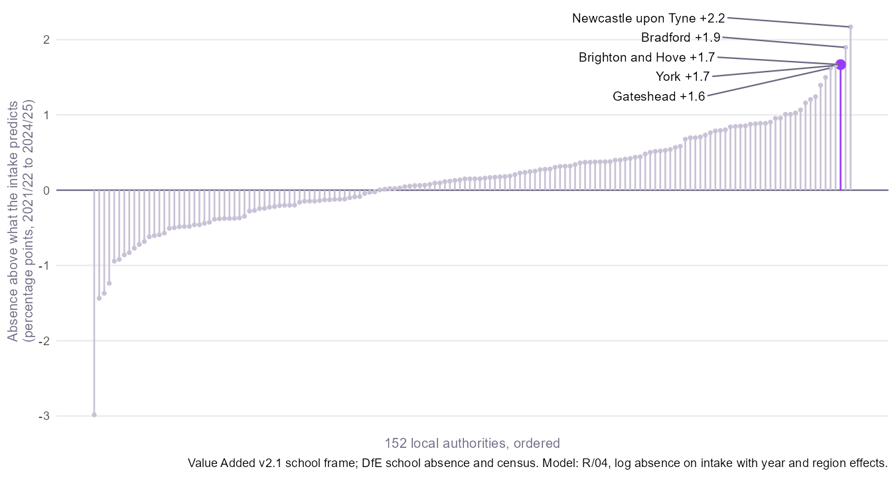

::: {.callout-note}
## About this page

This is the short version. [Key facts](key_facts.qmd) gives every figure here
with its source, its ranking and its caveat, and links to the pages that carry
the models. Everything is built from published DfE, Ofsted and ONS data;
nothing uses pupil-level records.
:::

## The hook

**The city has the 6th best local authority value-added effect of 152 in
England --- and its disadvantaged children leave school ranked 122nd of 152 on
raw Attainment 8.** Both are true. The second is the problem; absence is most of
the explanation.

.](writeup/figures/brief/0_hook_absence_vs_schools.png)

More: [Key facts, sections 1 and 2](key_facts.qmd#sec-success).

## 1. Our perception of a 'good school' is wrong

- Data shows parents in Brighton and Hove select schools on attainment, not on
  what the school adds.
- **Attainment 8 correlates with what a school adds at 0.27** nationally,
  **0.31** here.
- My analysis of the last four years of national data (confirming what has been
  known for decades in the school effectiveness literature) is that **schools
  themselves contribute only about 15% of the variation between schools at
  GCSE** --- the rest is who goes to those schools and where they come from.
- **But the council's admissions guide points parents to attainment.** Headline
  attainment score explains **84%** of how heavily a school is preferred; value
  added **20%**. So: disadvantaged intake → lower score → chosen less → intake
  shrinks → score falls. **Council guidance punishes the schools doing most for
  the poorest children.**
- **Fixing it is free, needs no consultation, and is the largest change modelled
  anywhere in my work.** Families reading value added instead: **BACA 90 → 174
  children on 180 places** (50% → 97% full); empty Year 7 places concentrated in
  three schools **93% → 75%**. The measure already exists.

.](writeup/figures/brief/1_ranking_flip.png)

More: [Key facts, section 3](key_facts.qmd#sec-measurement).

## 2. Absence --- the biggest lever. Brighton and Hove's absence is almost the worst in England, and this is over and above what poverty explains

- **Secondary absence 10.8% in 2024/25 vs England's 8.4%: 3rd worst of 152
  authorities** (DfE official; behind Knowsley and Bradford). Was 9th in
  2021/22, 7th in 2023/24. **Easing in 2025/26:** 9.8% vs 8.0% over autumn and
  spring, **6th**. Persistent absence **29.4%, 6th** in 2024/25.
- **Not poverty:** FSM **28.8%** vs England's 28.4%. **Suspensions 13.0 per 100
  vs 21.2.** Prior attainment 50th of 152.
- **Not explained by intake:** absence runs **+1.7 points above what our own
  pupils predict --- 3rd of 152**. Of 1.9 points of extra absence, **1.4 is
  authorised illness**; after intake our illness effect is **+27%, 2nd of 152**.
- **Worth: −3.2 Attainment 8 points** for disadvantaged pupils, and the gradient
  is **77% steeper** for them. Cutting absence a tenth is worth **3.5%** to them
  against 1.9% to everyone else --- the only big lever that narrows the gap.
- **Bring us to England's average: disadvantaged Attainment 8 33.9 → 36.9,
  122nd → 69th.** (+6.7 at BACA, +6.2 at Longhill, nil at King's and Patcham.)

More: [Key facts, section 4](key_facts.qmd#sec-absence).

## 3. Travel --- our poorest children travel furthest, almost uniquely

- **Across England deprived neighbourhoods are *closer* to a school --- true in
  81% of 293 districts.** Here they are **1.57 km vs 1.18 km: 33% further, 5th
  largest gap of 293**. **Of the 109 mostly urban authorities, none is worse.**
- **4.7 minutes further by walk and bus** (next worst Tameside 3.7); **18% of
  those journeys need two or more buses --- most of any authority in England**.
- **29 of 179 neighbourhoods --- 385 children --- can reach no school place
  within 30 minutes.** Access and child poverty correlate **−0.33**.
- **Cause: CoMArt closed in 2005.** A school back there closes most of the gap.

 page.](writeup/figures/brief/3_travel_gap.png)

More: [Key facts, section 5](key_facts.qmd#sec-distance).

## 4. A demographic time-bomb for schools in the city --- locked in, with a deadline

- **Year 7: 2,284 → about 1,825 by 2032/33, a fifth, 9th steepest of 159
  areas.** Those children are already in our primary schools. **~765 surplus
  places by 2033**, and **93% of today's empty Year 7 places sit in three
  schools**.
- **Longhill: roll 908 → 723 in four years; reserve £961k → £531k; about 3.7
  years left.** A decision with a deadline.
- **45% of our 47 maintained schools were in deficit in 2025-26** (England
  21%), 9th of 129 authorities. **In 2024-25 it was 58% --- the worst in
  England.** Nine of ten secondaries are spending reserves; the two deepest
  deficits are **Hove Park and Cardinal Newman**, not Longhill.

 page.](writeup/figures/brief/4_year7_fall.png)

More: [Key facts, section 6](key_facts.qmd#sec-demographics).

## 5. Why? --- It's fertility, not house prices

- **0.98 children per woman vs England's 1.39** --- about 70% of the national
  rate. On the three-year average, **joint 2nd lowest of 292 comparable
  districts**, level with Westminster, behind Cambridge.
- **House prices explain 7% of fertility differences between districts; women's
  education 27%.** Housing is a third of our gap and **none of the fall**.
  **Lewes, Mid Sussex and Wealden: same prices, fertility 1.45--1.58.**
- **Families do also leave --- 31st of 297 districts on net child migration**,
  to those same three districts. At **Year 7 that is about half the recent
  fall** (births −4.4, migration −5.1). We retain **90--94%** of our Year 6
  cohort against England's **98%**.

 page; the [note for the council](bh_births_note.qmd) has more.](writeup/figures/brief/5_fertility.png)

More: [Key facts, section 7](key_facts.qmd#sec-fertility).

## 6. What would help --- and what wouldn't

1. **Publish a value-added measure and point families at it.** Free, no
   consultation, biggest modelled effect. *(See 1.)*
2. **Attendance, as the city's first-order problem.** Biggest lever on results,
   particularly for disadvantaged children, and the most progressive one.
3. **A school children in the east can reach.** Longhill at Elm Grove,
   catchments redrawn: neighbourhoods reaching nothing in 30 min **29 → 15**;
   deprived journey gap **3.9 → 0.4 min**; **Whitehawk's disadvantaged children
   57 → 23 min**. Raises the segregation index (0.111 → 0.151) --- a cost under
   the council's aim, not on the evidence about outcomes.
4. **Consider how to improve secondary school accessibility and arrest terminal
   numbers issues in the East.** My new [Brighton and Hove school system
   simulator](https://apps.adamdennett.co.uk/bh_school_system/) allows us to test
   policies --- such as school relocation --- and their impacts on numbers and
   accessibility.

**And social mixing is the weakest lever available.** A school can reach
**~12%** of what separates its results; **42% arrives with the intake**, and
almost all the reachable part runs through **attendance** (workforce 2.5%, and
**0.8%** for disadvantaged pupils). Given prior attainment, disadvantaged pupils
do **slightly better** where more of their peers are disadvantaged. **BACA
proves it**: FSM **52.6%**, highest absence bar Longhill, and **+2.4 points of
value added for disadvantaged pupils**. The 2024 map lengthened disadvantaged
journeys 0.3 min and moved mixing 0.011 --- but **Whitehawk paid: 78 children a
year, +4.5 min for the disadvantaged, offered Longhill 22% → 5%**. The proposals
that fell would have displaced **6 → 40** children for **no gain in mixing** ---
and above ~15% priority 6 does nothing, demand runs out at 117 places, so Class
Divide's 30% = the council's 20%.

.](writeup/figures/brief/6_longhill_futures.png)

More: [Key facts, sections 8 and 9](key_facts.qmd#sec-mixing).
