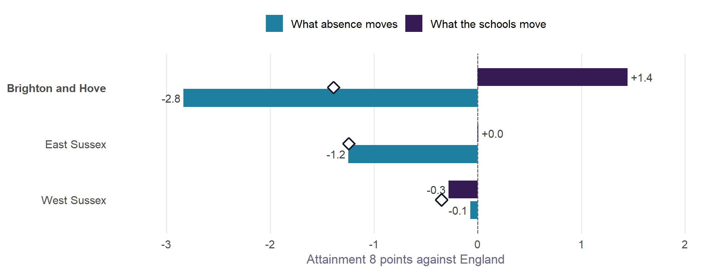
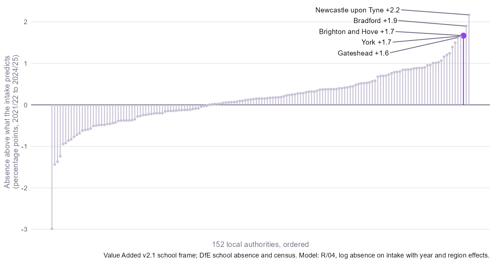
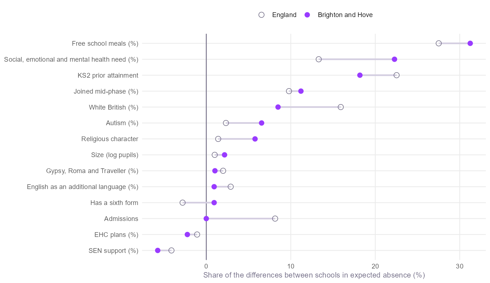
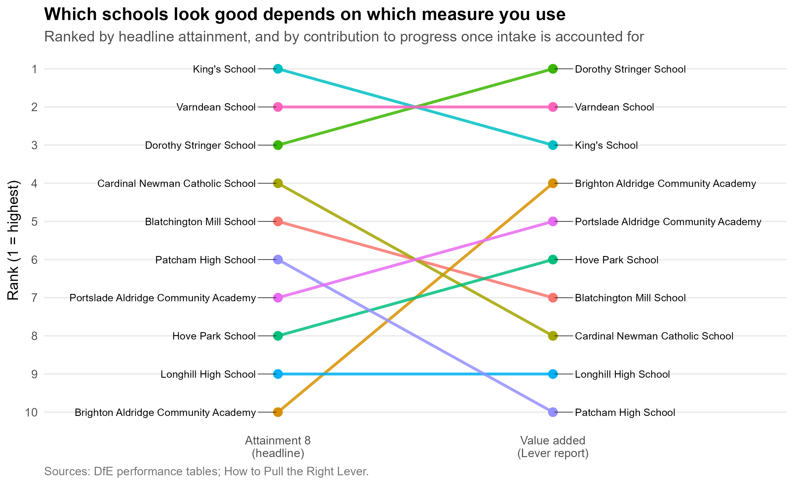
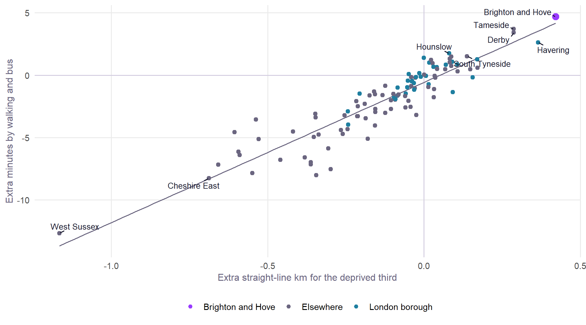
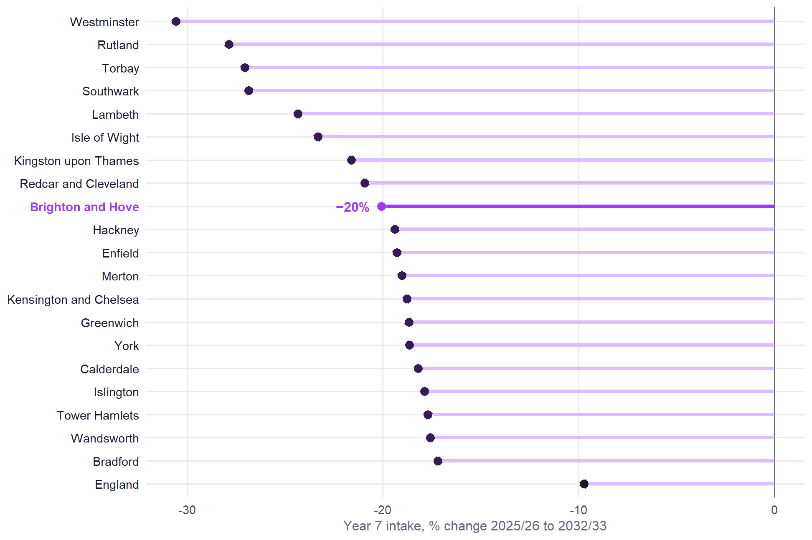
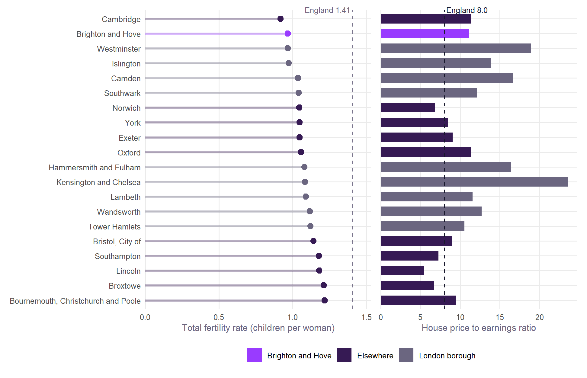
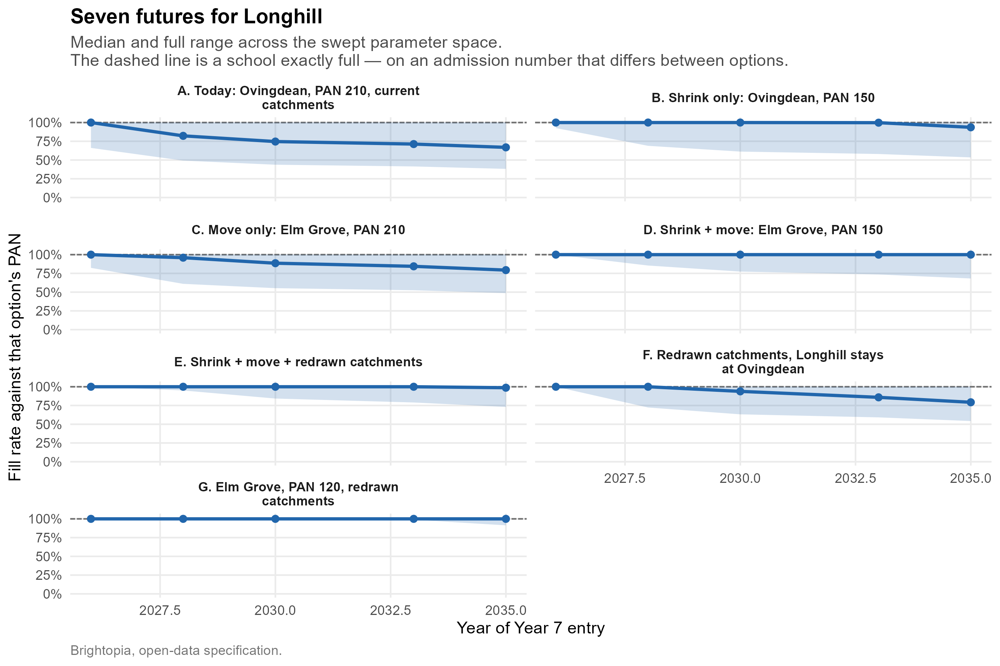
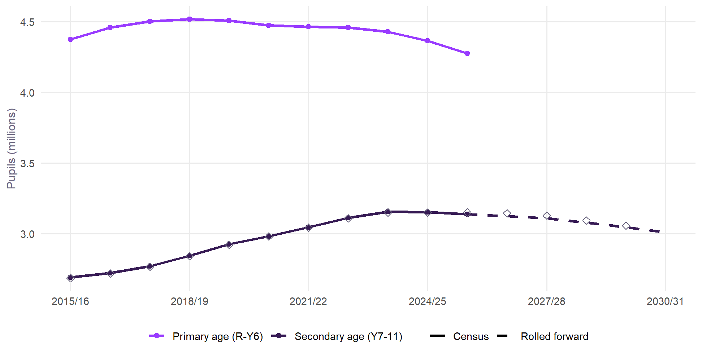

## Brighton and Hove is a national success story - and a unique concern

:::: {.columns}
::: {.column width="40%" .pts}
**GCSE Value added: 6th of 152** local authorities. 18th for Disadvantaged. 4th for Non.

BUT **Disadvantaged pupils' raw Attainment 8: 122nd of 152.** - before controlling for factors we know affect attainment.

Both are true. **The second is the problem**, and **absence** is most of the explanation.

Our schools add about **+1.4 points**; our absence takes away about **−2.8**.
:::
::: {.column width="60%" .fig}
{fig-alt="Bar chart: for Brighton and Hove, what absence moves (−2.8 Attainment 8 points) against what the schools move (+1.4), with East and West Sussex for comparison."}
:::
::::

::: {.src}
Value Added v2.1 local authority effects; DfE KS4 and absence.
:::

::: {.notes}
The city has the 6th best local authority value-added effect of 152 in England, and its disadvantaged children leave school ranked 122nd of 152 on raw Attainment 8. Both are true. The second is the problem; absence is most of the explanation.
:::

## Absence: B&H almost the worst in England, and beyond what poverty explains

:::: {.columns}
::: {.column width="40%" .pts}
Secondary absence **10.8%** vs England's 8.4% in 2024/25: **3rd of 152**. Easing to 6th in 2025/26 so far.

Not poverty: free school meals **B&H 28.8%** vs Eng 28.4%; suspensions low.

**Absence +1.7 points** above what our pupils predict: 3rd worst of 152, and **1st in 2024/25**. Mostly authorised illness.

If B&H absence at England's average, raw disadvantaged Attainment 8 moves from **122nd → 69th**.
:::
::: {.column width="60%" .fig}
{fig-alt="Lollipop chart: 152 local authorities' absence above or below what their intake predicts; Brighton and Hove is third highest at +1.7 points."}
:::
::::

::: {.src}
DfE, Pupil absence in schools in England; Value Added v2.1 frame (R/04, R/58).
:::

::: {.notes}
Persistent absence 29.4%, 6th, in 2024/25. Of 1.9 points of extra absence, 1.4 is authorised illness. It is worth −3.2 Attainment 8 points for disadvantaged pupils, on a gradient 77% steeper for them; cutting absence by a tenth is worth 3.5% to them against 1.9% to everyone else, the only big lever that narrows the gap.
:::

## What separates B&H's schools on absence is not quite England's pattern

:::: {.columns}
::: {.column width="40%" .pts}
Across England, **free school meals (28%)** and **KS2 prior attainment (23%)** separate schools most in expected absence.

In B&H free school meals still leads (31%), but **SEMH need matters far more: 22% against 13%** (persistent absence: 19% against 9%).

The schools differ widely on **autism** (4–13% of pupils; England 3%), mostly in mainstream intake, not specialist units. But actual **illness absence doesn't track it**.

No grammar schools here, so **admissions plays no part** (0%; 8% nationally).
:::
::: {.column width="60%" .fig}
{fig-alt="Dot chart: each characteristic's share of the differences between Brighton and Hove's schools in expected overall absence, beside England's; SEMH need and free school meals lead in the city."}
:::
::::

::: {.src}
National absence models applied to the city's 10 secondaries, autumn and spring 2025/26. Autism, SEMH: DfE SEN statistics, Jan 2026; FSM: school census; KS2: KS4 tables. Specialist provision: GIAS. Every kind of absence, the autism detail and every source: [Brighton and Hove page](areas/brighton_and_hove.html#absence-autism).
:::

::: {.notes}
Each characteristic's share of the differences between schools in the national model's expected absence (its coefficients times each school's values; a covariance split, so the shares add to 100%). Nationally free school meals and KS2 prior attainment lead. In Brighton and Hove, social, emotional and mental health need matters much more than nationally, for overall and especially persistent absence; the city's schools have nearly three times England's share of pupils with autism as their primary SEN need (8.9% against 3.0%) and differ widely on it, so autism is what the model's expected illness absence varies on most across the city (48%; not an artefact of ten schools). But actual illness absence does not follow autism share, and specialist provision explains only a small part: Varndean, Patcham and King's have shares above 10% with no resourced provision recorded. The city has no grammar schools, so admissions plays no part. With ten schools, one unusual school can move a share a long way.
:::

## The popular idea of a 'good school' is wrong

:::: {.columns}
::: {.column width="40%" .pts}
Preference data shows parents in Brighton and Hove choose schools based on attainment. Attainment explains **84%** of how heavily a school is preferred; value added **20%**.

Attainment 8 tracks what a school adds at only **0.27** nationally, **0.31** here.

What Schools do explains about **15%** of the difference between GCSE scores at the school average level. The rest is who goes there.

Council guidance when applying for places encourages this. Narrative in the city around the perceived golden ticket from attending some central schools, misleading.

Point families to value added: **BACA 90 → 174** children on 180 places. Free, and no consultation.
:::
::: {.column width="60%" .fig}
{fig-alt="Slope chart: the city's ten secondary schools ranked by headline Attainment 8 and by value added; Brighton Aldridge moves from 10th to 4th, Patcham from 6th to 10th."}
:::
::::

::: {.src}
DfE performance tables; How to Pull the Right Lever; Brighton and Hove school system model.
:::

::: {.notes}
Parents in Brighton and Hove select schools on attainment, not on what the school adds. The council's admissions guide points parents to attainment, so disadvantaged intake leads to a lower score, the school is chosen less, the intake shrinks and the score falls. Fixing it is free, needs no consultation, and is the largest change modelled anywhere in this work: BACA 90 to 174 children on 180 places; empty Year 7 places concentrated in three schools 93% to 75%.
:::

## Our poorest children travel furthest — almost uniquely in England

:::: {.columns}
::: {.column width="40%" .pts}
Across England, deprived areas are **closer** to a school in 81% of districts. Here they are **33% further**: 1.57 km vs 1.18 km.

**4.7 minutes further** by walk and bus — worst in England. 18% of those journeys need two or more buses.

**29 of 179 neighbourhoods** (385 children) reach no school place within 30 minutes.

The cause: **CoMArt closed in 2005**. 

A school in the near-East of the city closes most of the gap.
:::
::: {.column width="60%" .fig}
{fig-alt="Scatter of mostly urban authorities: extra km against extra minutes by walking and bus for the deprived third; Brighton and Hove is the largest on both."}
:::
::::

::: {.src}
School active travel routing (Zenodo 10.5281/zenodo.24188820); Census 2021; IMD 2025.
:::

## A demographic time-bomb — locked in, with a deadline

:::: {.columns}
::: {.column width="40%" .pts}
Year 7: **2,284 → about 1,825** by 2032/33, a fifth. 9th steepest decline of 159 LEAs.

About **765 surplus places** by 2033; 93% of today's empty Year 7 places sit in three schools.

Longhill: roll 908 → 723; reserve £961k → £531k, about **3.7 years** left.

**45%** of maintained schools in deficit in 2025-26 (England 21%); **58%** in 2024-25, the worst in England.
:::
::: {.column width="60%" .fig}
{fig-alt="Lollipop chart: the 20 steepest falls in Year 7 intake to 2032/33; Brighton and Hove falls about 20%, against about 10% for England."}
:::
::::

::: {.src}
DfE school census, cohorts rolled forward; DfE consistent financial reporting.
:::

## Why the decline? It's fertility, not house prices

:::: {.columns}
::: {.column width="40%" .pts}
**0.98 children per woman** vs England's 1.39: joint **2nd lowest** of 292 districts.

House prices explain **7%** of fertility differences between districts; women's education **27%**.

Lewes, Mid Sussex and Wealden: **same prices**, fertility 1.45–1.58.

Families do leave too: at Year 7 that is **about half** the recent fall. The neighbouring districts gain children, at much the same prices.
:::
::: {.column width="60%" .fig}
{fig-alt="The lowest-fertility districts in England, with Brighton and Hove second, beside their house price to earnings ratios."}
:::
::::

::: {.src}
ONS birth rates by local authority; ONS housing affordability; Census 2021. More in the [note for the council](bh_births_note.html).
:::

## What would help — and what wouldn't

:::: {.columns}
::: {.column width="40%" .pts}
**Publish a value-added measure** and point families at it. Free, no consultation, biggest modelled effect.

**Treat attendance** as the city's first-order problem: the biggest and most progressive lever.

**A school the east can reach:** Longhill at Elm Grove cuts neighbourhoods with no school in 30 minutes from 29 to 15.

**Social mixing is the weakest lever available**: a school can reach only about 12% of what separates its results.
:::
::: {.column width="60%" .fig}
{fig-alt="Seven small panels: Longhill's Year 7 fill rate to 2035 under seven options."}
:::
::::

::: {.src}
Brighton and Hove school system model and [simulator](https://apps.adamdennett.co.uk/bh_school_system/).
:::

## The national ask

:::: {.columns}
::: {.column width="40%" .pts}
**Attendance is where the disadvantage gap sits.** Nationally absence explains **56%** of school Attainment 8, deprivation 21%. Severe absence: 1.2% → 3.6% of pupils.

**Falling rolls need a national framework.** England's Year 7 will be about **10% smaller** by 2032/33. Rolls fall first; money follows.

**Publish a contextualised measure beside Attainment 8.** One exists, free, for all 3,265 secondaries.
:::
::: {.column width="60%" .fig}
{fig-alt="England: primary-age pupils peaked around 2019 and are falling; secondary-age pupils peaked in 2023/24 and fall to 2030/31."}
:::
::::

::: {.src}
DfE school census, cohorts rolled forward; How to Pull the Right Lever; Value Added v2.1.
:::
